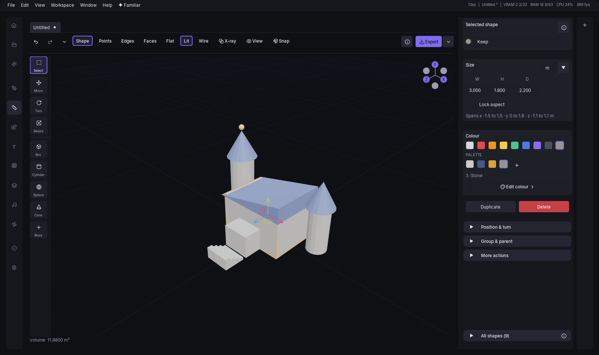
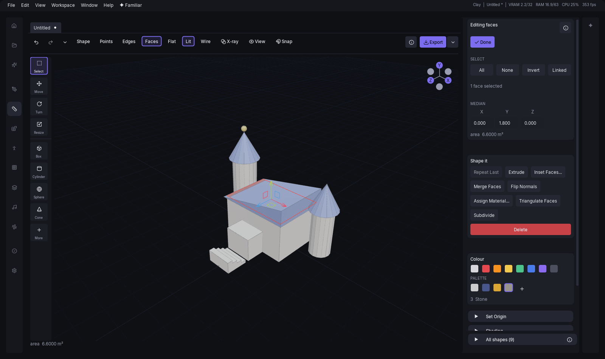
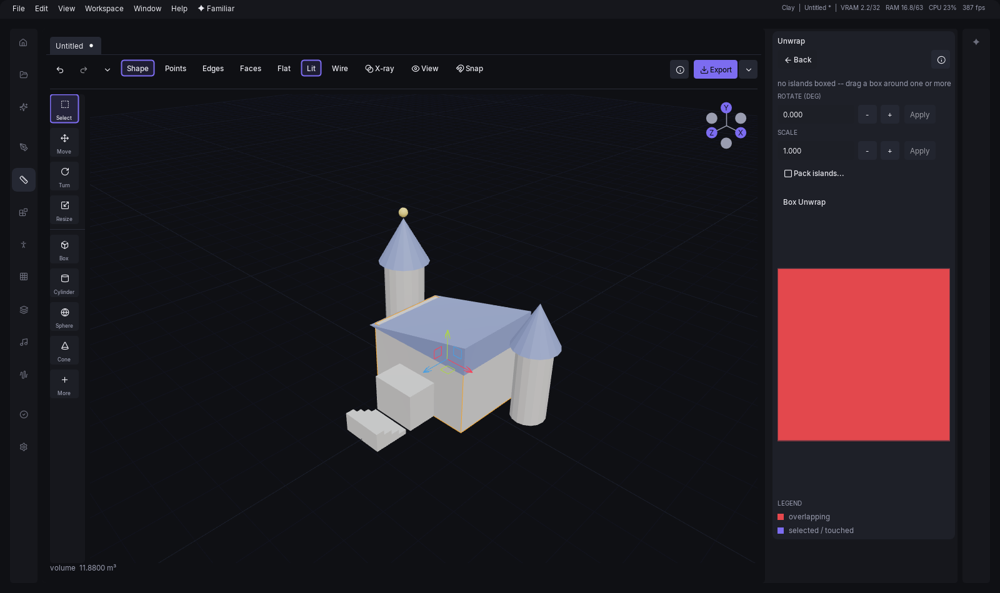
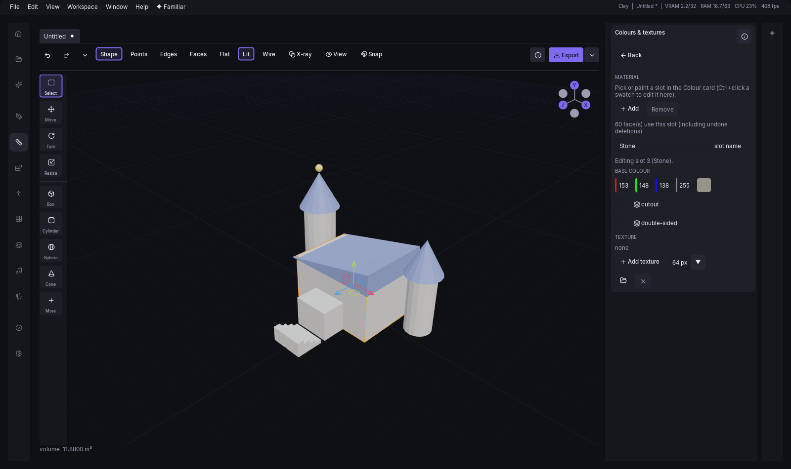

# Clay

Clay is the top-level modelling mode: a small, low-poly modeller with a material palette and
box-projected textures, in the same window as everything else. It exists because the pipeline has one
weak spot that no prompt fixes — if you already know the shape you want, describing it to a diffusion
model and hoping is a poor way to get it. Clay lets you say it directly.

It is deliberately a small tool, in the spirit of picoCAD and Blockbench rather than of Blender: shapes
you place, faces you push and pull, a transform gizmo and a handful of whole-object operations. There
is no modifier stack, no sculpting, no collision-shape editor and no bake — what you see is the mesh,
and the mesh is what leaves. A texture is painted in Inker, which Clay opens for you and takes the
picture back from (see [Texturing](#texturing)), and a game-ready cleanup is the library's.

It is a mode, not a takeover. Switching away leaves every open document exactly where it was. Only
quitting the app can lose unsaved work, and it asks first.

The layout is picoCAD's more than Blender's: almost the whole window is the viewport. Down its left
edge runs a slim, labelled **tool rail** — the four transform tools and the shapes — and over it the toolbar;
under it only a one-line hint. (There is no menu bar over the viewport: see
[Where the operations live](#where-the-operations-live).) On the right is one pane, the **Inspector**, a panel that
changes with what you have selected (see [The inspector](#the-inspector)) and holds the document's colours in
its **Colour** card, with the list of every shape in the document, **All shapes**, docked at its foot (see
[The outliner](#the-outliner)). There is no left-hand column and no separate file pane. Several documents
stay open at once.

## Starting a document

With nothing open, the middle column offers **Start with a box**, **New model** and **Open a file...**.
**Start with a box** opens a new document with one box already in it, standing on the ground and in
view, so there is something to work on at once; **New model** opens an empty one. The column also lists the
documents you had open recently — clicking one reopens it, and hovering it shows the full path. There
is no separate file pane: every file command is in the **File** menu, which is where Clay's own rows sit among
the ones every mode has — **New**, **Open...**, **Open Recent**, **Import Mesh...**, **Save**, **Save As...**,
**Export to library**, **Export GLB...**, **Export OBJ...** and **Save Screenshot...**, with **Undo** and **Redo**
beside them (and as two buttons in the toolbar). `Ctrl+N` and `Ctrl+O` do the same two things from the
keyboard.

Choosing **Clay** from the Home screen opens an empty document for you when there is nothing open
already. When there is, it leaves your documents exactly as they were — the documents *are* the
work, and entering the mode is not a reason to disturb them.

If you would rather be walked through a first model, **Take the tour: Building a wall torch** (in
the palette, and offered on Home) builds a low-poly torch from an empty document: a box for the
plate, two cylinders for the shaft and collar, a low-segment cone for the flame, then colours,
**Save** and **Export to library**. Its building steps keep **Next** greyed until the part they ask
for is in the model, and each offers **Skip step**; the tour only reads the document, so ending it
changes nothing in it.

## Adding a primitive

A document with nothing in it says so in the viewport itself — "Add a shape", with "Pick one from the tool rail"
underneath and a button that drops a box on the ground — rather than leaving you to notice an
empty grid and go looking for a shape on your own.

The **tool rail** down the left edge of the viewport has the four transform tools at the top — **Select**,
**Move**, **Turn** and **Resize**, each with its name under the icon (see [Transforming](#transforming)) — and,
under a divider, four shapes as one-click buttons (Box, Cylinder, Sphere and Cone) and a **+** button.
**+** opens a flyout that lists all the shapes **by name**, and the Inspector's **More shapes** list, with nothing
selected, is the same list. When the window is too short for the
four shapes under the tools, they are not drawn at all and the **+** is labelled **Add** instead of
**More**: the flyout is then the way to every shape, the four included. **Primitives**: box, plane, grid,
cylinder, cone, UV sphere, icosphere, torus and capsule. **Game**: wedge, ramp, rounded box, stairs,
wall and doorway. That is fifteen, and it is the whole list — Clay no longer builds pyramids, arches,
columns, lathes, sweeps or tubes, because the curve editor that drove the last three went with them;
a column is a cylinder. Hovering a rail button says what it does and which key picks it, and a fresh
document does not arrive with a shape already picked.

Clicking a shape places it and selects it (in an element mode it is placed but left unselected, so the Inspector keeps
showing the pick you were editing), and the place is chosen for you. It **stands on the ground**,
its lowest point exactly on the grid plane, and it lands **beside** what is already there rather than
inside it: the first shape goes at the origin, and each later one takes the nearest free spot (the
search runs outward in half-metre steps, leaves a gap of about 15 centimetres and snaps to an eighth of
a metre). When exactly one object is selected, the search starts from it, so the new shape lands next
to the one you are working on. Only if there is no free spot within about twelve metres does a shape
stand on top of what is under it instead. The first shape in a model also **frames the view**, and a
later one does only when it would otherwise be off screen, and then the whole model is framed so
nothing already built is lost. The shape is painted with the **colour you last picked** in the
Inspector's Colour card (Ctrl+click only opens a slot to edit, so it does not count), and with the starting
grey before you have picked one. All of it is part of the one undo step the add already was: Ctrl+Z
removes the shape and leaves nothing behind. An agent's `clay_add_primitive` is unchanged and puts a
shape at the origin, wherever its own translation then sends it.

A shape's own numbers — a cylinder's `radius`, `height` and `segments`, say — are not set before it
is placed: they are edited on the object itself, in the Inspector's Shape settings, once it exists. With
nothing selected the Inspector offers the same shapes as four big cards (Box, Cylinder, Sphere and Cone)
and a **More shapes** list of the rest; a click on either is the same click as on the rail.

Shapes arrive with their shading already set, by an angle rule: a face is smooth when it meets its
neighbours at a shallow angle all the way round, and flat otherwise. So a sphere, an icosphere, a
capsule and a torus come in smooth, and a box and the flat-panelled game shapes come in flat. A
**cylinder and a cone come in flat too**, and that is the rule working rather than missing them —
every face on the side band meets a flat cap at a right angle, and smoothing the band on its own would
round the cap's rim, which is the edge the cap is there to define. Shade Smooth and Shade Flat
override any of this whenever you want them to.

The game shapes are the pieces a level is blocked out of: each one is a thing you would otherwise
build from three boxes and then have to keep in one piece. A **wedge** is a box with one end cut away
to a sharp edge — a doorstop, a buttress, a roof end. A **ramp** is the same triangular prism lying the
other way, described the way you actually think about a ramp: how `wide` it is, how `long` the run is
and how `high` it climbs. A **rounded box** is a box with its four upright edges rounded off by
`radius`, which is what stops a crate or a kiosk reading as a programmer's placeholder; `segments`
decides how smooth the rounding is, and a radius of zero gives you a plain box back. **Stairs** is a
single flight, built as one continuous surface rather than a pile of blocks: `steps` of them, filling
`total_height` and `total_depth`, with `closed_underside` deciding whether it is a solid mass or an
open flight you can see under. A **wall** is a box named for the job, with `length`, `height` and
`thickness` in the order you would say them. A **doorway** is that wall with a rectangular opening
cut through it, the opening's `width`, `height` and `offset` from centre given directly.

Three of the basic shapes are near-duplicates of others and are worth telling apart. **Grid** is a
plane cut into squares; **plane** is the single quad, which is what a decal or a backdrop wants, and a
grid is what you need the moment you want to bend the sheet, because only interior vertices can move.
**Icosphere** and **UV sphere** are both balls: the icosphere's triangles are all much the same size,
which is what makes it the one to push and pull, and the UV sphere is laid out in latitude and
longitude, which is what makes it the one to wrap an equirectangular texture round. **Capsule**'s
`height` is its cylindrical middle alone, so the whole shape is that plus a radius at each end.

A placed object remembers *how it was made*. Its generator and the parameters it was built with are
kept, so the Inspector's Shape settings offer those parameters — a cylinder's radius, height and segment
count — and changing one rebuilds the mesh. That is a single undo step, so `Ctrl+Z` takes the
object back to the shape it had rather than to some intermediate state.

A rebuild keeps your shading. Change something that leaves the face count alone — a radius, a height
— and whatever shading the object had, hand-picked or automatic, comes through untouched. Change
something that alters the faces themselves, like a segment count, and the shading is worked out
again by the same rule the object arrived with, because they are not the same faces any more.

## Where the operations live

Clay has no menu bar over the viewport: the first row above the render is the [toolbar](#the-viewport-header).
Every operation Clay has is in three places, and all three are drawn from one table, so a name, a key, a
greyed-out reason or a dialog of numbers cannot differ between them:

- **The Inspector.** In Shape mode, **More actions** on a selected shape lists every whole-shape operation in groups
  — Transform, Set Origin, Mirror, Parent, Rig, Join, Shading, Clean Up, Smooth,
  Separate, UV — with **Duplicate** and **Delete** as rows of their own. In Points, Edges or Faces the **Select**
  row holds Select All, Select None, Invert Selection and Select Linked, and **Shape it** holds what the mode edits
  with: repeat last, extrude, inset, bevel, loop cut, edge slide, merge faces, weld, flip, triangulate, subdivide
  and Delete, with Topology (dissolve, bridge, fill hole, collapse), Set Origin to Selection and, in face mode,
  Shading and Separate Selection behind folds of their own. See [The inspector](#the-inspector).
- **The right-click menu** in the viewport lists exactly the operations that apply in the current mode, in the
  same order, with the groups separated by rules.
- **`Ctrl`+`K`**, the command palette, lists all of them under a **Clay** heading (below).

A row that cannot run is greyed and hovering it says why; one with an ellipsis opens a small dialog of numbers
first. In Shape mode, Select All, Select None and Invert Selection have no Inspector button: they are `Ctrl+A`,
`Ctrl+D` (or `Esc`) and `Ctrl+Shift+I`, and rows of the right-click menu and the palette.

Two things you might look for in an Add menu live elsewhere. The shapes are the tool rail's **+** and the
Inspector's tiles and **More shapes** list (see [Adding a primitive](#adding-a-primitive)). **Import Mesh...**
is on the Inspector's **Model & history** page, next to the units and up axis it uses; it is also in the **File**
menu and in `Ctrl`+`K` (see [Importing an asset](#importing-an-asset)).

That is the whole list. Clay has fifty-eight operations, and every one is in the right-click menu, Frame
Selection included (it is also in the toolbar's View popover):

| Group | Operations |
| --- | --- |
| Select | Select All (`Ctrl+A`), Select None, Invert Selection (`Ctrl+Shift+I`), Select Linked (`L`, element modes) |
| Object | Duplicate (`Ctrl+J`), Merge Objects... (`Ctrl+M`), Union Objects (`Ctrl+Shift+M`), Difference Objects, Intersect Objects, Recalculate Normals, Simplify..., Smooth..., Delete (`Delete`) |
| Object ▸ Transform | Drop to Ground, Snap to Grid... |
| Object ▸ Set Origin | Origin to Bounds, Origin to Base, Origin to World; Origin to Selection in an element mode |
| Object ▸ Mirror | Mirror X, Mirror Y, Mirror Z, Mirror Copy... |
| Object ▸ Parent | Group Selected, Ungroup, Parent to Last, Clear Parent |
| Object ▸ Rig | Add Bone, Mark as Bone, Unmark Bone, Unbind Skin; in Pose mode Insert Key (`I`), Delete Key, Reset Pose, Apply Pose as Rest |
| Object ▸ Shading | Shade Smooth, Shade Flat (also in face mode) |
| Object ▸ Separate | Separate Loose Parts; Separate Selection (`P`, face mode) |
| Mesh | Repeat Last (`Shift+R`), Extrude (`E`); in face mode Inset Faces... (`I`), Merge Faces, Flip Normals, Assign Material..., Subdivide, Triangulate Faces (`T`); in edge mode Bevel Edges... (`Ctrl+B`), Loop Cut... (`Ctrl+R`), Edge Slide... (`Ctrl+Shift+R`); in vertex mode Weld... |
| Mesh ▸ Topology | Dissolve (vertex and edge modes); in edge mode Bridge Loops and Fill Hole; Collapse (edge and face modes) |
| UV | Box Unwrap, Pack Islands... |
| (toolbar) | Frame Selection (`F`) |

Select None has no key of its own: `Esc` steps back through the selection, and `Ctrl+D` deselects.
Everything with a key is also in [Keyboard shortcuts](35-shortcuts.md).

Every operation is also searchable. With a Clay document open, `Ctrl+K` lists them under a **Clay** heading with their
keys printed on the right, so *extrude*, *mirror*, *merge objects* or *box unwrap* finds its row whether or not you
remember which group it was in. An operation that works only in another mode (Extrude, from Shape mode) is listed
greyed, and hovering it says which mode to switch to. An operation with an ellipsis opens its dialog, as the menu does.
The same list carries the four tools, the five modes, the three shadings, X-ray, the overlays, the six axis views,
Orthographic, Frame selection, **Import Mesh...** and the exports: the controls of the toolbar and the tool rail,
changed the same way.

## The viewport header

The toolbar is one row across the top of the viewport, and it is where everything you
change *between* clicks lives: which element mode you are in, how the surface is drawn, what the viewport
shows over the model, whether snapping is on, and the way out of the document, all next to the model they are
about. Left to right it holds:

- **Undo**, **Redo** and a small chevron beside them that opens the **history**: every step, with the
  newest marked, and a click on one goes there. Undo and Redo are greyed when there is nothing to take back
  or put back, hovering one says why, and they do exactly what `Ctrl+Z` and `Ctrl+Y` do. The history jump
  is refused in the middle of a drag, as the chords are.
- The **mode switch**: **Shape**, **Points**, **Edges**, **Faces**. Shape is the whole-object mode; the
  other three are vertex, edge and face editing, on the keys `1`, `2` and `3`, and `4` is Shape. Hovering a
  segment names its key. When the window is narrow the words shorten to **S**, **P**, **E** and **F**, and
  the switch is never folded into a menu, because a mode picker you cannot see is no use.
- The **shading switch**: **Flat**, **Lit**, **Wire**. *Lit* is the lit render — what the object will look
  like. *Flat* is the colours with no lighting, and it is what you model in: it shows silhouette and
  topology without a highlight sitting on the vertex you are dragging. *Wire* replaces the surface with
  its edges entirely.
- **X-ray** (`Alt+Z`) makes the surface see-through, so an element behind it can be picked. It is off by
  default because it changes what a click *selects* as well as what is drawn.
- **View**, one popover that holds what the viewport draws and where the camera looks from. Under
  **Overlays** it lists **Grid** (with its size in metres), **Wireframe over surface**, **Statistics** and
  **God light**; under **Views** the six axis views, each with its key, then **Orthographic** and **Frame
  the selection**. The button stays lit while any overlay is not at its default. See [Axis views](#axis-views).
- **Snap**, a button that opens the numbers behind it — a grid size and an angle. It stays lit while the
  setting is on, so a shut popover still says what is armed, and it does not grey out while a document is
  saving: it touches nothing in the document. See [Snapping](#snapping).
- At the far end, the **(?)** and **Export**, a split button. Its main click is **Export to the library**,
  the same as the button on the Inspector's Model card; it is greyed, with the reason on hover, when there is nothing
  visible to send. The chevron beside it lists **Export to the library**, **Export GLB...**, **Export
  OBJ...** and **Save screenshot...**, each greyed with the same reason.

The row is in four groups, divided by thin rules, in the order you reach for them: **history** (Undo, Redo and
the chevron), **mode** (Shape, Points, Edges, Faces, Pose), **display** (the shading switch and X-ray, how the
surface is drawn) and **aids** (View and Snap). A group that folds into the `…` menu takes its rule with it.

The tools (Select, Move, Turn, Resize) live on the rail beside the viewport and nowhere else. When the
window is too narrow for the whole row it gives up labels before controls: first the View, X-ray and Snap
words become icons, then the shading words and the mode words become letters, and then View, X-ray, Snap
and the shading switch move into a `…` menu with their full words back. Undo, Redo and the mode switch
never move, and neither does Export.

The **Grid** is a fixed size — 100 m by default, in 1 m cells, with a brighter line every ten of them
— rather than one that follows whatever is on screen, and its own field sits under the Grid row in the
View popover, from 1 to 1000 m. Pressing `F` to frame the selection moves the camera only; it
neither resizes the grid out from under you nor turns the view — you keep looking from the same angle.
The size is remembered across sessions, the way the switch itself already was.

Three marks on the grid say where you are standing in the world: a **red line** along the X axis, a
**blue line** along the Z axis, and a dot at the origin where they cross.

**God light** replaces the ordinary render with a single light straight down from 100 m overhead onto
a flat ground plane under the grid — a deliberately flat, shadowless look for checking silhouette and
proportions rather than the lit render you model under day to day.

### Statistics

The **Statistics** overlay puts one line in the top-left corner: objects, vertices, edges, faces and
triangles, and how many are selected in whichever element mode you are in. It answers "is this mesh
500 triangles or 50,000", which is the question that decides whether a low-poly model is finished.

The edge figure is the count of *distinct* edges, not of face corners: a cube reads 12, not 24.

### The navigation widget

The six balls in the top-right corner of the viewport are the world axes seen from where you are
standing. The lettered ones are the positive ends — X, Y, Z — and their unlettered opposites sit
behind them, which is how the widget tells you which way round you are looking without a label. Click
any ball to look along that axis; it is the same jump `Ctrl+1`, `Ctrl+3` and `Ctrl+7` make, with the
back views one click rather than a chord.

### The hint line

The line under the viewport says what the mouse and the keyboard do *right now*, and it changes with
the mode, the tool and whether a drag is running. It is there because most of the selection verbs are
not buttons: `L` for everything connected, a box select held behind `Shift` or `Ctrl`, `Shift` and
`Ctrl` to add and remove. It is written in plain words — click, drag, hold Shift — and never names a
mouse button by abbreviation. Without the line the only way to find out what a mode can do is to read
this chapter.

## Element modes

Every object starts as one thing you can move about. Press `1`, `2` or `3` and it becomes a mesh you
can take apart: vertices, edges, faces. `4` goes back to object mode. The mode switch in the
viewport toolbar says the same thing — **Shape**, **Points**, **Edges**, **Faces**, shortening to **S**, **P**,
**E**, **F** in a narrow window — and highlights whichever mode the document is in. The switch reads left to
right in the order of the modes (Shape first), so the keys under it run `4`, `1`, `2`, `3`.

| Key | Mode | What clicking selects |
| --- | --- | --- |
| `1` | Points | One vertex |
| `2` | Edges | One edge |
| `3` | Faces | One face |
| `4` | Shape | The whole object |

The mode belongs to the *document*, not to the app, so switching tabs does not reinterpret what you
had selected in the other one.

**The shape you are editing stays selected.** Pressing `1`, `2` or `3` with a shape selected keeps it
selected, so the Inspector and the All shapes list still show it, and `4` brings you back to the same
shape. With several shapes selected they are all edited together. With nothing selected the mode still
turns on, and the first element you click makes its shape the one being edited. What you pick *inside*
the shape is separate, and `Esc` drops it without ending the edit.

In object mode a selected object is drawn with an **orange outline** along its edges, so you can tell
what a transform or a delete will act on, and the object under the pointer lights up before you click
it. In an element mode the selected elements are highlighted instead.

Going from one element mode to another carries the selection across. Down — faces to edges to
vertices — takes everything the selection touches. Up takes a face only when *every* one of its
edges (or corners) is selected, so two edges of a triangle do not select the triangle.

Clicking replaces the picks, `Shift`+click adds to them and `Ctrl`+click removes from them. Clicking an
element of a different shape makes that shape the one being edited (`Shift`+click adds it to the edit
instead, and `Ctrl`+click never takes a shape out of it). Clicking the shape but missing everything on
it clears that shape's picks; clicking empty space with the **Select** tool (`Q`) clears all the picks.
Neither ends the edit. **Dragging empty space looks around** (orbits the view), in every mode and
under every tool, and it never selects or deselects anything, so the first thing a newcomer tries does no
harm. A click on empty space only counts as a click if the pointer stays within about four pixels of where
it went down; drag farther than that, even if you come back, and it was a drag.

To select several at once, hold `Shift` and drag a box (it adds to what is selected) or `Ctrl` and drag
one (it removes). A box takes a vertex inside the rectangle, an edge only when *both* ends are inside, and
a face only when *all* its corners are — and it selects through the mesh, back face included, because that
is what a rectangle dragged over a blockout means. The box works under every tool, and it may start on the
model itself: a `Shift`- or `Ctrl`-press on an element waits to see whether you drag, so a click still
adds or removes that element and a drag becomes a box. A box with no area changes nothing.

`Alt`+drag orbits too, in every mode, even when the press lands on something you could pick. That is the
one gesture that is never reinterpreted, since it is how you look at what you are about to click. In object
mode a drag on empty space orbits and leaves the selection alone; only a click there deselects, and object
mode has no box select.

Right-click opens the context menu, listing exactly the operations that apply in the current mode with the ones that
cannot run greyed out. The same table drives the Inspector's action buttons and the palette's rows, so none of them
can offer something another refuses. Operations that take a number — inset, bevel, loop cut, edge slide, weld,
assign material, merge objects, snap to grid, mirror copy, pack islands, simplify, smooth — open a small dialog with
the fields and an **Apply** button, and remember what you last used.

Distances in the Inset, Weld and Bevel fields are world metres. Clay divides them by the object's own
scale before applying them, so `0.1 m` is 10 cm on screen whatever the object's scale. For a non-uniform scale the
geometric mean of the three axes is used. An object with a zero scale refuses the distance. An element operation
on several objects that would take the document past its size ceilings is refused as a whole: no object is changed and
no undo step is recorded.

`Ctrl+A` selects everything in the current mode's sense of everything, `Ctrl+Shift+I` inverts it, and
`Esc` steps back: first it closes an Inspector page if one is open, then it drops the picks, then it leaves
the element mode (the shape stays selected), then it clears the object selection. In an element mode `Ctrl+A`
and `Ctrl+Shift+I` work on the shape
being edited, or on every visible shape when none is, so inverting never pulls in a shape behind it.
`Delete` in an element mode deletes the picked *faces*, never the object (in Points and Edges mode only the faces whose
every corner or edge is picked; a pick that covers no whole face is refused with a sentence saying so), and is greyed
until something
is picked. In object mode it
removes every selected object as **one** undo step rather than one per object, so a single `Ctrl+Z`
brings the whole selection back. Neither
`Ctrl+A` nor `Ctrl+Shift+I` reaches a **hidden** object, in either sense of everything: hiding
something takes it out of what you are working on, so nothing you select can act on it by accident.
Delete, Duplicate and element drags leave a hidden object alone too, without a message.

**Element selection is transient.** It is not saved with the document, and an undo that changes
geometry drops it — the indices it named describe a mesh that no longer exists. An undo that only
moves or renames something keeps it, because those cannot invalidate it. An Inspector or agent
edit that rebuilds a shape from its own parameters is different again: if it comes out with the same
faces in the same order (every change to a size, however many are changed at once) the selection, any
per-face paint and the UV layout are carried through unchanged, and so is the shading. Two counts that
trade places for the same face total (a torus's segments and sides, a sphere's segments and rings)
rebuild different faces under the same numbers, so the selection goes and the paint falls back to the
object's own slot. If the face count shrinks the selection is *restricted* to whatever indices still
exist rather than left pointing past the end of a smaller mesh.

### Selecting more than one thing

Clicking picks one element and `Shift`-clicking adds another, and `Shift`- or `Ctrl`-dragging a box takes
(or removes) everything inside a rectangle. `L` selects everything **joined** to what is selected — the way to
pick one of two shapes that were welded into one mesh, and what Separate Selection is about to split off. Clay has no
select-more or select-less, no loop or ring pick and no select-by-similarity: it is a small tool, and
a box and `L` between them reach what a low-poly model needs.

### The operations

| Mode | Operation | What it does |
| --- | --- | --- |
| Any | Extrude (`E`) | Pulls the selection off the surface and walls in the gap, then starts dragging what it made — along the face normal in face mode, free in edge and vertex mode. |
| Faces | Inset Faces (`I`) | Shrinks each face in place and rings it with the rim it vacated. The key starts a drag for the thickness. With *treat selection as one region* on, the cap's texture shrinks with the geometry and the rim gets the band of texture between the old edge and the new one, as a per-face inset always did. |
| Edges | Bevel Edges... (`Ctrl+B`) | Replaces each selected edge with a flat strip the width you give and rebuilds the corners where beveled edges meet: bevel one edge of a box and the two faces at that edge's ends become pentagons, bevel all twelve and the box has 26 faces. One flat segment, not a rounded profile, and a bevel wider than the feature it sits on stops just short of the middle of each edge it slides along, so it flattens the feature without folding it or leaving two corners on one point. The key starts a drag for the width; a width typed below 0.001 m is raised to 0.001 m. An edge on a boundary, or one that three faces share, is refused with the reason; so is a selection that touches more than 10,000 corners (half that on a mesh with UVs), which would freeze the window. |
| Edges | Loop Cut... (`Ctrl+R`) | With exactly one edge picked, rings the strip of quads that edge belongs to with a new loop of edges, cut at the position you give along each rung (0.5 is the middle; the field takes 0.01 to 0.99, because 0 or 1 would only duplicate a point). The ring stops at the first triangle, n-gon, open border or edge shared by three faces it meets, so a partial ring is normal; a face at the end of a stopped ring takes the new point into its outline and becomes an n-gon rather than leaving a crack. Texture coordinates are interpolated along each cut, so a cut across a seam leaves the seam where it was. The new ring is left selected. Refused above 400,000 corners on one object. |
| Edges | Edge Slide... (`Ctrl+Shift+R`) | Moves the picked edges sideways along the faces either side of them, each end of an edge along its own two sideways rails, so a loop you have just cut can be put where the form wants it. The field runs from -1 to 1: 0 does not move anything and 1 would put an end on its neighbour, so the field stops just short of it at 0.99. Which direction is negative depends on the mesh's own point numbering, so try the other sign if it went the wrong way. Only positions move; topology, texture coordinates and materials are untouched. A point with no sideways edge outside the selection is refused by name. Refused above 65,536 points. |
| Faces | Subdivide | Splits each face into quads without changing the shape. |
| Faces | Flip Normals | Reverses the winding of the selected faces. |
| Faces | Assign Material... | Paints the selected faces with one palette slot, given by its number in the Colour card's palette, and leaves the object's default slot alone. See [Texturing](#texturing). |
| Faces | Triangulate Faces (`T`) | Replaces each selected face with its own triangles. |
| Faces | Merge Faces | Merges a connected block of selected faces into one n-gon. |
| Points, Edges | Dissolve | Removes the selected element and keeps the surface closed: a point merges the ring of faces around it into one n-gon, an edge merges the two faces either side of it. A point or an edge on a boundary has no ring or no second face, so it is refused, naming the element; Fill the hole first, or Delete. |
| Edges | Bridge Loops | Joins two selected boundary loops of the same length with a strip of quads. Both loops must be open boundaries (delete the faces between two interior rings first), and a closed loop cannot be bridged to an open chain. |
| Edges | Fill Hole | Caps the boundary ring each selected edge belongs to with one n-gon. A ring that pinches or visits a vertex twice is refused. |
| Edges, Faces | Collapse | Pulls each connected run of selected edges, or block of selected faces, down to one vertex at its centre. A bare point selection is refused: that is Weld. |
| Points | Weld | Merges vertices closer together than a distance you give. Two vertices closer than the distance weld. Inside a longer run of closely spaced points a vertex joins a group only if it is within half the distance of the group's leader (the first vertex in coordinate order), so a chain is cut into pieces rather than collapsed into one, and a pair closer than the distance can stay apart when neither is near a leader. The distance is limited to 50 m, and a distance big enough to leave the object with no faces at all is refused, naming the distance. A weld of more than 20,000 vertices at once (a big mesh with every point selected) takes a faster, rougher pass. It sorts the points into cells the size of the distance and keeps a point only if it is within half the distance of the average position of the points sharing its cell. It never welds a pair farther apart than the distance, but it can leave a closer pair apart: in a test, 792 of 2,000 pairs at half the distance welded, against all 2,000 below the limit. Weld a smaller selection to get the exact search. |

An operation that cannot do what you asked says so in a toast naming the element and what to do
instead, and changes nothing. Those are refusals, not failures: the alternative is geometry that
looks right and is not.

**Merge Faces** is the way to get one face where there were several: a selection that falls into
several disconnected blocks becomes one face *per block*, not one face overall — a face with a hole
in it is not something this editor's meshes can hold, so there would be nothing to make. And a
single face on its own is refused: there is no neighbour to merge it with. When the faces you merge
disagree about material or smoothing, the merged face takes the material and smooth/flat setting of the
lowest-numbered of them.

### Dragging an operation's number

**Inset** (`I`), **Bevel** (`Ctrl`+`B`), **Loop Cut** (`Ctrl`+`R`) and **Edge Slide** (`Ctrl`+`Shift`+`R`) do not
open their dialogs from the keyboard. They start a **drag**: move the pointer and the result is drawn live, with the
operation, the number and its unit beside the cursor (`Inset thickness 0.050 m`, `Bevel width 0.050 m`). The
distance starts at nothing and grows with how far the pointer has travelled from where you pressed the key.

Loop Cut's and Edge Slide's numbers are positions, not distances, so they work the other way round: Loop Cut starts
at 0.5, the middle of each rung, and Edge Slide at 0, where nothing has moved, and moving the pointer sideways
slides the number, the full width of the viewport covering the whole range (`Loop cut position 0.500`, with no
unit).

Click or `Enter` commits, and it commits **once**: one undo step, the same mesh you would have got from
the dialog at that value, and the **Last action** card appears afterwards so the number is still in reach.
`Esc` or a right-click cancels, and since nothing is written until the commit the document is exactly as
it was — not even a redraw's worth of change in the history. **Type a number** (`0.1`, then `Enter`) and
the pointer stops mattering: the value is exactly what you typed. A value the operation refuses is
named beside the cursor, and an object that refuses the value is drawn as it is in the document, so the picture always
matches what `Enter` would commit. Inset needs a thickness or a depth; both zero is refused.

A click on the same row in the right-click menu or the palette still opens the dialog, which is the way to give
several numbers at once or to pick a value you would rather not find with the mouse.

On a very large mesh the preview is redrawn at most about ten times a second once a single redraw
takes more than about 50 ms, so the pointer stays responsive; the commit always runs the real operation
at the pointer's final value.

**Extrude** is one operation in all three modes, because it means the same thing in all three. In
edge mode it grows a quad from each selected *boundary* edge — an edge with a face on each side has
no open side to grow into, and it says so. In vertex mode it extrudes the border edges between the
vertices you selected, which is the only reading available: a mesh here stores faces, not loose
wires, so a vertex on its own has nothing to extrude and says that too.

Pressed as `E`, Extrude also begins a move of what it made — in face mode **locked to the average
face normal**, which is the direction an extrusion goes (`X`, `Y` or `Z` swaps that for a world
axis, and `G`, `R` or `S` switch to a free move, rotation or scale). Click or `Enter` ends it as **one**
undo step; `Esc` or a right-click undoes the extrude as well, so nothing is left behind. The right-click menu's
and the palette's Extrude do not start a drag. `E` extrudes only in an element mode; in object mode it does nothing.

### Adjusting the last operation, and repeating it

An operation that takes numbers and is run in an element mode — inset, bevel, loop cut, edge slide, weld, assign
material — leaves a **Last action** card in the [Inspector](#the-inspector), under **Shape it**; the object-level
ones (merge objects, snap to grid, mirror copy, pack islands) open a dialog but leave no card. It is headed with the
operation's name and holds the same fields the dialog had, and changing one re-runs the operation from the state it
started in: you see the new thickness on the mesh, and the whole thing is still **one** undo step, the same mesh you
would have got by running the operation at that value in the first place. If the new value is one the operation
refuses, the previous result stays on screen and the card says why.

The card is there only while the model is exactly as the operation left it. Any later edit, an undo, a
change to what is selected or a change of mode hides it, because from then on "change the thickness" would no
longer mean "redo that operation".

**Repeat Last** (`Shift`+`R`, and the first button of **Shape it**) runs the last such operation again,
at the same values, on whatever is selected now — inset one face, select another, press it. It remembers
per document, so an agent's own document repeats only what the agent did; with nothing to repeat it says
so.

The first operation that changes an object's topology **freezes** it. A box that has been extruded is
no longer describable as "box, size 1", so the Inspector's Shape settings switch from the generator's
parameters to a vertex and face count.

## Transforming

Rotating and scaling turn about the **median of the selection** — the point the gizmo is drawn at.
With two objects selected the ring is drawn at the median and the document turns about it, rather
than each object spinning about its own origin, and a single object whose origin is not at the centre
of its bounding box orbits the ring you can see.

Four tools, on `Q`, `G`, `R` and `S`, which are also the four buttons at the top of the tool rail (the rail
calls Rotate **Turn** and Scale **Resize**):

| Tool | Key | What it does |
| --- | --- | --- |
| Select | `Q` | Click an object in the viewport to select it. With something selected it shows the move gizmo, so a selection can be dragged without switching tool. |
| Move | `G` | Three arrows and three plane handles between them; drag an arrow to slide along that axis, or a plane handle to slide in that plane. |
| Rotate | `R` | Three rings; drag one to turn about that axis. |
| Scale | `S` | Three handles plus a centre handle for uniform scale. |

`G`, `R` and `S` do two things at once: they light the tool, so its gizmo appears, and with something
selected they start a keyboard drag of that kind (see [Moving without a handle](#moving-without-a-handle)). The pointer
is measured on a plane facing the screen, so a horizontal mouse move never changes depth and `R` turns about the view
axis.
`E` is not a tool; it is Extrude, and only in an element mode.

A drag is one undo step, recorded when you let go — not one step per frame of the drag, which would
bury everything else in the history.

The gizmos work on elements too. In an element mode they sit at the centre of what is selected
*inside* the objects rather than at the object's own centre, and dragging one moves those vertices.
That is one undo step per drag, and a drag that ends where it started records nothing at
all. **Select** (`Q`) shows the move gizmo for an element selection just as it does for an object, and
the box select still works with `Shift` or `Ctrl` held: dragging the gizmo moves the selection, and
dragging empty space looks around.

The **Move**, **Rotate** and **Scale** values are also typed directly in the Inspector, under **Position &
turn**, which is the better way to place something exactly. Position and scale boxes are labelled X, Y and Z;
**Scale** is one fold further down, under **Advanced**.
**Rotation is in degrees**, turned X, then Y, then Z -- the same three numbers an agent's
`clay_transform` takes, so what an agent set and what the panel shows are one thing. (The object
itself stores an `XYZW` quaternion, which is what every file this app writes uses.) A rotation can be
written more than one way -- 190° is the same turn as −170° -- so while you are typing, the angles stay
exactly as you typed them; they are read afresh from the object the moment anything else turns it, a
gizmo drag or an undo.

The object's **size**, width, height and depth, is the **Size** card at the top of the Inspector, and it is
the one place to type a size. It is the mesh's own extent times the object's scale, so typing a new width
sets that axis's scale to match and nothing else. **Lock aspect** carries the other two axes along by
the same ratio. An axis the mesh has no extent on -- the height of a plane -- has nothing to scale from, so
the card says so and ignores an edit to it. Below the boxes, **Spans** is the read-only box around the
object *after* it is rotated and placed -- the number a scale of 2 on a generator whose radius is 0.35 does
not tell you, and the same box the camera frames against. Type a number and press `Enter` or click
anywhere else: the size is applied once, as one undo step, not once per digit.

A taller height keeps the shape **standing where it is**: the lowest point of the shape stays put and the
shape grows upward, so a box on the ground does not sink into it. Width and depth keep the middle. If a
size you type makes the shape reach past the edge of the view, the camera frames the model, as it does for
a new shape that would be off screen.

The small combo on the Size card's heading picks the **unit** sizes and positions are shown in --
metres, centimetres, millimetres, inches or feet. It changes only what the fields display and
accept; the document, and every file it writes, stays in metres. The import-scale choices on the
Model & history page are the same table.

### Moving without a handle

`G` moves the selection, `R` rotates it and `S` scales it, with no handle grabbed: the drag follows the
pointer until you click to commit or press `Esc` to put it back. In Points, Edges or Faces a negative scale
factor (a typed `-1`) is refused, because it would turn the picked faces inside out; use Mirror to flip
them. A typed `0` is allowed and flattens the picked elements onto a plane. Every transform in Clay used to go
through grabbing a coloured arrow, which means finding it, which means never moving an object without
first looking at the gizmo rather than at the model.

Scaling a whole object along one axis (a handle, or `X`/`Y`/`Z` then a number) scales along that world axis. For a
shape turned in whole quarter-turns that is exact; for any other turn Clay refuses with a message, so use the Size
card or unlock the axis. A uniform scale always works.

`G`, `R` and `S` also switch which transform a *running* drag is doing — "move it; no, turn it" is one
gesture rather than a cancel and a restart. The objects go back to where they started first, so a
rotate that follows a half-finished move is measured from the original position and not from wherever
the abandoned move left them.

Each of the three is also its tool's letter, so the key and the tool never disagree: after pressing
`R` to turn something, the Rotate tool is the one lit, and its rings are what you grab next. With
nothing selected the key only chooses the tool. `Shift`+`R` is not a tool; it is Repeat Last.

A keyboard drag holds no mouse button, so a **press** is how it ends: left commits, right cancels.
Everything else behaves exactly as it does under a handle drag — the axis lock, the typed value and
`Esc` are the same code and are described next.

While a move, rotate or scale is live — and the same for a rotate or scale in the UV view — whatever would
land in the middle of it is greyed or refuses: the swatches, the **+**, every Add button, the outliner and
the Inspector's Position, Rotation and Size cards all say "Finish the drag in progress first (Enter or click
to commit, Esc to cancel)." An Inker texture pull waits for a live Clay gesture as well, and lands on the
first frame after it ends.

### Locking an axis, and typing a number

The keyboard joins a drag already under way. While a gizmo is held:

| Key | What it does |
| --- | --- |
| `X` / `Y` / `Z` | Lock the drag to that axis. The same key again clears the lock. |
| digits, `.`, `-` | Type the value outright — metres for a move, degrees for a rotation, a factor for a scale, and the unit of an inset's thickness or a bevel's width while dragging one. |
| `Backspace` | Take back the last character. |
| `Enter` | Commit and end the drag. |
| `Esc` | Cancel it: everything goes back where it was and nothing is recorded. |

A readout beside the cursor says what the drag currently amounts to, so `X` then `2` is "two metres
along X" with no dragging left in it. The two compose, and they are different in kind: a lock says
which *direction*, leaving the mouse in charge of the amount, while a number is the amount. That is
why a number on its own still means something — it sets the distance along whichever way you were
already dragging, and the size of a uniform scale.

### Whole-object operations

Several operations act on the whole selection at once, and all of them are one undo step however
many objects or copies they touch. **Duplicate** (`Ctrl+J`) makes a copy under a new name, counting
up — `Box`, `Box.001`, `Box.002`. Duplicating or mirror-copying a group copies its children too; the copies sit under
the copied group.

**Drop to Ground** rests each selected object's own world box on `y=0`, one at a time rather than as a
group, so an object already on the ground and one floating three metres up both land correctly in the
same press. It reads the geometry's box, not the pivot, so a barrel authored with its pivot at the
middle no longer floats half its height in the air. **Snap to Grid...** rounds every selected
object's world position onto a grid of the given step (at least 0.001 m; a smaller value is refused), each axis
independently — unlike **Snap** below, this acts once on whatever is already selected rather than following a live
gizmo drag.

## The outliner

The outliner is **All shapes (N)**, the section docked at the foot of the [Inspector](#the-inspector), with the
number of shapes in the document in its name. Closed, it is a single header row; click the row to open it, and
click it again to close it. Open, it takes a fixed share of the column (about a quarter, never fewer than four
rows, and never so much that the Inspector above it is squeezed past a few cards), and the Inspector's own body
scrolls in what is left. The list does not move or change size when you pick a different shape or the Inspector
changes what it shows, so the row under the pointer is the row you clicked: that is what makes `Ctrl`-click and
`Shift`-click safe to aim. Whether it is open is remembered; the first time it is drawn it is open while nothing
is selected or the document is empty, and closed otherwise. A page of the Inspector (Colours & textures, Unwrap
and Model & history) takes the whole column, and the list comes back when you leave it. The (?) on the header
opens this section.

Every object in the document, in document order — the oldest root first, each with its subtree under
it. Click to select, `Ctrl`-click to toggle one and
`Shift`-click to take a range. The filter box above the list narrows it by name.

The eye on each row hides an object, and a hidden object does not render, does not export and cannot
be clicked in the viewport. **Solo** above the list hides everything *except* what is selected and
**Show all** brings them back — each is a single undo step, so `Ctrl+Z` is a third way out.

All three are on the keyboard too: `H` hides the selection, `Shift`+`H` isolates it (the same as Solo)
and `Alt`+`H` shows everything again. Hiding clears the selection, since a hidden object is no longer
something you can act on; the eye and the visibility box do the same, and `Ctrl+Z` on a hide shows the object
again without selecting it. A hidden row in the outliner cannot be selected: clicking or right-clicking it leaves the
current selection as it is, and its Duplicate is greyed. Show the object with the eye first. A hidden object is skipped
by drags and by element operations all the same.
In an element mode `H` hides the shape being edited and leaves the mode on with nothing being edited, until
you click an element of another shape.
`Alt` plus any other letter, digit or `Delete` does nothing in Clay: only `Alt`+`H` and `Alt`+`Z` (X-ray) are
bound, and `Alt`+drag orbits.

Rows are dragged to reorder them, which matters because display order is the order the objects come
out in an exported GLB. A drag that reaches the top or bottom edge of the list scrolls it. Reordering is
switched off while the filter box has something in it: the rows on screen are then a subset, so there is
no honest answer for where a drop between two of them lands in the real list.

Right-clicking a row that is not selected selects it; the menu offers **Rename**, **Duplicate**, **Solo** and
**Delete**. The **...** button at the end of every row opens the same menu without a right-click. There is no
trash button on the row: Delete is in that menu, on the Inspector and on the `Delete` key. When the row is part
of the selection, Duplicate, Solo and Delete all act on the whole selection (Delete is one undo step); otherwise
on that row alone. Double-clicking a name renames it in place. The name box takes the keyboard straight away;
**Enter** or a click elsewhere keeps the new name, **Esc** leaves the old one. Which groups are collapsed, the
Shift-click anchor and a rename in progress belong to the document they were made in, not to every open Clay
tab.

The list is a tree. An object with children is indented under its parent and has an expander beside
it; collapsing one hides its subtree, except while the filter box is in use, where a match buried
under a collapsed group still has to be findable. Where a row is dropped decides what the drop
means: onto the middle of a row makes the dragged object that row's child, while between two rows places
the dragged object beside that row, as a sibling under the same parent (a row dropped beside a child becomes
that parent's child; beside a root it becomes a root), in one undo step. A drop that would put an object
inside its own subtree is refused and says so.

## The inspector

The Inspector, the whole of the right-hand column, is one panel whose body follows what you have selected,
so what you can do to the thing in front of you is always in front of you. Its body scrolls; the
[All shapes](#the-outliner) list is docked under it and does not.

| You have selected | The Inspector shows |
| --- | --- |
| Nothing | **What do you want to make?**: four shape cards, a **More shapes** list, **Next shape's colour**, and the **Model** card |
| One shape | Its name and colour, then **Size**, **Shape settings** (when it has any), **Colour**, **Duplicate** and **Delete**, and three closed folds |
| Several shapes | **Colour**, **Duplicate** and **Delete**, and the actions for several shapes; no size |
| Points, edges or faces | **Editing points** (or edges, or faces) with a **Done** button, then a **Select** row, what is picked and its median, **Shape it**, right after an operation with numbers **Last action**, and the **Colour** card |

**With nothing selected** the panel is the first screen of a model. The four cards place a Box, Cylinder, Sphere or
Cone exactly as the rail's buttons do, **More shapes** lists every other shape, **Next shape's colour** is the
Colour card with nothing to paint (a click only picks the colour the next shape you add will wear), and the
**Model** card under them is the document: a line of counts of what leaves it (`9 shapes · 4 colours · 254 vertices
· 227 faces · 472 triangles`, the visible shapes only, the same set the exporters write, so the triangle count is a
promise about the exported file), **New**, **Open...**, **Save** and **Save as...**, the ways out under **Take it
somewhere** with a line naming the last export, and a **History** row. Press `Esc` with one shape selected to let go
of it and get this screen back.

**With one shape selected** the panel opens on the shape's name, which is a field (type a new one and
press `Enter`), and the colour it wears. Under that:

- **Size** is described under [Transforming](#transforming).
- **Shape settings** are the shape's own numbers, one box per parameter the generator has (a cylinder's
  `radius`, `height` and `segments`). A box or a plane has none beyond its size, so it shows no such card.
  A change rebuilds the mesh as one undo step; an object that has been edited or imported has no
  parameters left, and says it is frozen, with its vertex and face counts.
- **Colour** is eight named swatches -- Stone, Red, Orange, Yellow, Green, Blue, Purple and Charcoal. A click
  paints the shape (or every selected shape) in that colour, **finding the slot in the document's palette that
  already holds the colour or adding one named after it**, all as one undo step. The eight exist only in the
  panel: a new document still has exactly one grey slot, and a slot appears in the palette only when a
  click asks for it. The swatch the shape wears is outlined: the slot every face of it names, or the one you last
  Ctrl+clicked while the shape still wears what it did then. A shape whose faces wear different slots outlines
  nothing, and the line under the palette says Mixed. A colour that is none of the
  eight (one you edited, or a textured slot) outlines a ninth swatch in its own colour instead. Under the
  eight is **the palette itself**: every slot of the document, in order, the ones the eight made among
  them, and a **+** that adds a grey slot and paints the shape with it (see
  [Painting faces](#painting-faces) for what a click does). **Edit colour** opens the Colours & textures
  page for the shape's slot.
- **Duplicate** and **Delete** run the same operations as `Ctrl`+`J` and `Delete`. A refused one is
  greyed and says why on hover.

Then three folds, closed until you open them (the Inspector remembers which are open):

- **Position & turn** holds the position and rotation boxes, and a fold of its own, **Advanced**, with
  scale -- the shape compared with the mesh as first made, which Size makes unnecessary for nearly everything.
- **Group & parent** holds the parent choice and **Clear parent**; see [Parents and groups](#parents-and-groups).
- **More actions** lists every whole-object operation, generated from the same table as the right-click menu,
  in groups: Transform, Set Origin, Mirror, Parent, Rig, Join, Shading, Clean Up, Smooth, Separate and UV. Each button
  says what it does on hover, with its key, and is greyed with the plain reason when it cannot run. An
  operation that takes numbers (Snap to Grid, Mirror Copy, Pack islands, Simplify, Smooth) opens its fields right
  below the group with an **Apply** button, and remembers the values for next time; the same fields open from the
  right-click menu. **Texture mapping** opens the Unwrap page.

**With several shapes selected** the panel says so in its heading and offers the Colour card (one click paints them
all, as one undo step; the palette row is there too), Duplicate, Delete, and More actions already open, where Group,
Merge Objects, Parent to Last and the Mirror operations are. There is no Size card: select one shape to change its
size.

**The three pages.** A few things need the whole column, so they open as pages over the Inspector, under a
**Back** button; `Esc` does the same, ahead of everything else it undoes (a page closes first, then the picks,
then the mode, then the selection).

| Page | Opens from | What it holds |
| --- | --- | --- |
| **Colours & textures** | **Edit colour** | The selected slot's name, colour, cutout and double-sided, and its base-colour texture (make one, edit it in Inker, take it back), with **Add** and **Remove** for slots; the swatches themselves are in the Colour card |
| **Unwrap** | **Texture mapping** | The selected object's texture layout, described under [The UV view](#the-uv-view) |
| **Model & history** | The **History** row | The whole document: the file row, counts, the undo history, the import units and up axis, the last export, and the **Export GLB** and **Export OBJ** buttons |

The page is remembered while the app is open and is the same for every document. In an element mode the
Colours & textures and Texture mapping pages are one click below **Shape it**.

The history is a button with the step count: press it for the whole undo stack, oldest first, with the head
marked and the undone steps greyed, and click any row to move there in one go.

**In Points, Edges or Faces** the heading says what you are editing (**Editing faces**) and **Done** goes back to
Shape mode with the shape still selected, the same as the header's **Shape** and `Esc`. The body is the same
four things in every element mode, and what the mode offers is drawn from the same table as the right-click menu,
so the three never disagree:

- **Select** is a row of **All**, **None**, **Invert** and **Linked**, the same operations as `Ctrl`+`A`,
  `Ctrl`+`Shift`+`I` and `L`. Each is greyed with a reason when it has nothing to act on (Linked wants something
  picked first).
- Under it, a line says what is picked — `3 faces selected`, or `4 faces selected across 2 shapes` when the edit
  spans several — or, with nothing picked, what to click: *Nothing selected. Click a face, or hold Shift and drag
  to select several.* The selection's **median** position follows as X, Y and Z in world space, and the boxes
  are typeable: enter a value and the selected elements move so their median lands there. Each entry is **one
  undo step**. With nothing picked the boxes stay where they are, greyed, so nothing below them moves when the
  first pick lands. Edge and face mode add a line with the length of the selected edges or the area of the
  selected faces.
- **Shape it** holds the mode's operations as buttons: **Repeat Last**, **Extrude**, and in face mode
  **Inset Faces...**, **Merge Faces**, **Flip Normals**, **Assign Material...**, **Triangulate Faces** and
  **Subdivide**; in edge mode **Bevel Edges...**, **Loop Cut...** and **Edge Slide...**; in point mode **Weld...**;
  and **Delete**, which deletes the picked elements and never the shape. The groups that are used less
  (**Set Origin**, and in face mode **Shading** and **Separate**) are closed folds under the card. Hover shows what
  a button does and its key; a button that cannot run is greyed and says why. An operation with numbers (the ones
  with `...`) opens its fields right under its button with an **Apply**, remembers the values for next time, and
  counts as one undo step.
- **Last action**, described under [Adjusting the last operation](#adjusting-the-last-operation-and-repeating-it),
  appears under **Shape it** while an operation's numbers are still live.
- **Colour** is the same card as in Shape mode, under Last action: in Faces mode a swatch paints the picked
  faces, and in Points and Edges mode it holds only the palette.

Below them, **Colours & textures** and **Texture mapping** open those pages for the shape being edited: painting a
face and laying out an island are what an element mode is for.

## Parents and groups

**Parenting** makes one object follow another. Drag a row onto another in the outliner, or select
the objects and press **Parent to Last**: everything else in the selection becomes a child of the
topmost selected object. Nothing moves when you do it — the child keeps exactly the place it had —
and from then on moving the parent moves the whole subtree. **Clear Parent** frees an object again,
also without moving it.

Moving a rotated shape under a non-uniformly scaled parent would shear it, and Clay cannot store a shear
as a position, rotation and scale. So it bakes the shear into that shape's own geometry and carries the
shape's children with it: each child keeps exactly the place it had, however many generations down, and a
sheared empty (which has no geometry to bake) hands its shear to its children instead. It is still one
undo step. Parent to Last, Clear Parent, Group, an outliner drop, Delete of a parent whose sheared child
has children of its own, and Merge Objects all do this.

A child's position, rotation and scale are measured *relative to its parent*, so the Inspector's
fields are labelled "local" once an object has one. That is why a wheel at local zero sits at the
car's origin rather than the world's. An object can never become its own ancestor; a drop that would
make a loop is refused and says so.

**Group Selected** is parenting with a holder made for you: an empty object appears at the centre of
what you selected, with everything parented to it. If you select an object and something already
parented to it, only the topmost of them is parented to the empty, so the hierarchy below it stays as
it was. The empty has no geometry of its own — it draws
nothing and exports as a bare node — so it is purely a handle for moving a set of things as one. Drop to Ground,
Mirror, Origin to Bounds or Base, Box Unwrap, Pack UV Islands, Separate Loose Parts, Recalculate Normals, Simplify,
Smooth and Shade Smooth or Flat tell you so when only groups
are selected. **Ungroup** dissolves it and leaves the children where they stand. Duplicate and Delete are greyed out,
with a reason, when the only objects selected are hidden.

Deleting a parent never takes its children with it: they attach to the parent's own parent, keeping
their place in the world. If a child sits at an angle under a parent scaled unevenly, ungrouping or deleting the parent
keeps the child's shape where it stood by baking the skew into its mesh: a shape built from a generator (box, sphere and
so on) stops being a generator shape and loses its size fields, as after any other mesh edit. If that child has
children of its own the delete or ungroup is refused, with the rule above, and nothing changes.

## Separating and origins

**Separate Loose Parts** splits an object wherever its geometry is not actually connected, and
**Separate Selection** (`P`, in face mode) pulls the selected faces out into an object of their own.
Each is one undo step, each piece keeps the original's place and parent, and an object with nothing to
split says so rather than making a pointless copy.

An object's **origin** is the point it rotates and scales about, and where its Inspector position
is measured. Four operations move it without moving the geometry: **to Bounds** (the centre of the
object's box), **to Base** (the middle of its underside, which is what makes an object sit on a
floor cleanly), **to Selection** (the centre of what is selected in an element mode) and **to World**
(the world origin). Children stay exactly where they are while the pivot moves under them.

## Measuring

The hint line under the viewport answers the question the selection implies. Two selected vertices
show the distance between them; three show the angle at the middle one; a face selection shows the
total area; and in object mode a selection shows its volume — or "open mesh" instead of a number
when any selected object has holes, because the volume of an open surface is not a volume. Counts,
distance and area ignore hidden objects, so they match what a drag would move.
Everything is measured in world space, so a scaled parent is accounted for rather than ignored.

## Merging objects

**Merge Objects...** (`Ctrl+M`, object mode, two or more selected) turns several shapes into one.
The survivor is the **topmost selected object in the outliner** — it keeps its name, its transform
and its default material — and everything else is carried into its frame, appended to its geometry
and removed from the document. That is one undo step: a `Ctrl+Z` that put one absorbed object back
while the survivor still carried the merged geometry would show you a shape existing twice.

Only objects you can see are merged. A hidden object stays hidden and untouched even when it is
selected, and **Merge Objects...** greys out unless two visible objects are selected — hiding
something means it is not part of what you are working on, and a merge is the one operation where
absorbing an unseen object would leave no trace of having done so.

The dialog asks for a **weld distance**, in metres of world space. Vertices closer together than
that are merged into one at their centroid, which is what makes two shapes that *touch* come out as
a single continuous surface rather than as two shells sharing a plane. Setting it to zero keeps
every vertex, which is the honest answer for parts that are meant to stay separate inside one
object. The distance means the same thing whatever the survivor is scaled to: 1 mm is 1 mm on the
ruler, not 1 mm in whatever units the survivor's own transform happens to work in. The distance is limited
to 50 m, and a distance big enough to leave the merged object with no faces at all is refused, naming the
distance. When the merged object has more than 20,000 vertices the weld uses the same faster pass as Weld in
Points mode: it never joins vertices farther apart than the distance, but it can leave some closer pairs apart.
Merging objects that have no geometry is refused with "There is nothing to merge".

The weld is applied to the **whole merged result**, not only where the shapes meet. That is what
lets three objects touching at one point come out joined, and it costs nothing for ordinary work —
texture coordinates are stored per face corner, so a weld carries a UV break through untouched. Two
things leave vertices sitting at one position, and the weld joins them. One: merge at zero to keep
two parts as separate shells, then merge *that* object with a third at a non-zero distance, and the
shells you kept apart are welded together. Merge the third one first, or keep the parts as separate
objects until last. Two: an Extrude you have not moved yet leaves its new ring exactly on the old
one, so merging at a non-zero distance welds the ring back flat and the extrude vanishes. Move the
extruded faces before you merge, or merge at zero.

It is a weld and not a solid union. Geometry inside an overlap is kept rather than cut away:
two interpenetrating cubes come out as one object still carrying both sets of interior walls.
[Booleans](#booleans), below, cut it away. For a low-poly model that is usually fine, because the buried
faces cost nothing you can see; where it is not, delete the faces inside the overlap in face mode.

A merged object is no longer what a generator would build, so its generator claim is dropped along
with the merge — the Inspector stops offering the size field that would have rebuilt a
pristine box over your work. That drop is part of the same undo step.

### Booleans

**Union Objects** (`Ctrl+Shift+M`), **Difference Objects** and **Intersect Objects** (object mode, two or more visible
objects selected) are the solid-geometry cousins of Merge Objects: they cut away the part that overlaps instead of
keeping it. Union fuses the shapes into one solid and drops the surfaces buried inside the overlap. Difference cuts
every other selected shape out of the **topmost selected object in the outliner**, which is the one that survives and
the one cut from, so the order of the outliner decides which shape is the block and which is the hole. Intersect keeps
only the volume every selected shape has in common. Like Merge, the survivor keeps its name, its transform and its
default material, and the whole press is one undo step.

They cost three things, and Merge Objects is still the right tool whenever those matter:

- **The result is triangles.** The geometry kernel works in triangles, so a union of two boxes comes back as a
  triangle mesh, not as quads. Subdivision-friendly topology does not survive.
- **Texture coordinates are dropped.** A boolean recuts every face it touches, so no corner of the result matches a
  corner of an input. Run Box Unwrap on the result and add its texture again.
- **Every input must be a closed solid.** An open surface has no inside. The refusal says which fix applies: Weld an
  object whose points are split between faces, Recalculate Normals on one that is inside out, or fill the holes of
  one that has them. A result with nothing in it (an intersection of shapes that do not overlap, or a difference that
  removes everything) is refused rather than leaving an empty object.

The triangles of all the selected objects are counted together before anything is computed, and past 2,000,000 the
press is refused and changes nothing. A press near that size takes several seconds, because the geometry is computed
on the thread that draws the window.

## Bones and rigs

A **bone** in Clay is an ordinary object that has been marked as one, the way BlockBench treats a group as a
bone: its origin is the joint's pivot, its own transform is the joint's rest pose, and the bones' hierarchy is the
parent chain between them (a group you did not mark, sitting between two bones, is skipped). Nothing else about the
object changes, and an empty group is as good a bone as a box is.

**Mark as Bone** and **Unmark Bone** are in the right-click menu's Rig group, in the outliner row menu, in the
palette and on the Inspector's **Bone & rig** card, whose **bone** checkbox does the same. A bone wears a bone
glyph in the outliner and the Model card counts them ("2 bones"). A document holds at most 64 bones, the number
the viewer's skinning and the skeleton editor already hold; marking a 65th is refused.

**Add Bone** makes a bone with no shape of its own, for a joint that is only a joint. With one bone selected the new
one is added under it, a step above, so repeating it grows a chain upward like a spine; otherwise it is added at the
origin. Move it into place with the gizmo, and give it a name that says what it is: the names are what an imported
animation is matched on. Bones are drawn in every mode, so an empty one is still there to pick.

There are two ways a shape is bound to a bone, and only one of them is stored.

- **Rigid** binding is the outliner: a shape that sits under a bone, however many groups down, moves with its
  nearest bone, with every point at full weight. Nothing is saved for it, so deleting or unmarking the bone
  simply unbinds the shape, and the card says which bone a shape moves with.
- **Weighted** binding is a per-point weight against several bones, which Clay does not paint: it arrives with an
  imported rig, or from Blender's automatic weights. A weighted mesh wears a link glyph, and the card names its
  bones. Moving its points is fine and keeps the weights. Anything that changes how many points it has (extruding,
  subdividing, welding, bevelling), joining it and separating it are refused with a sentence naming **Unbind
  Skin**, which drops the weights and keeps the shape; so is deleting or unmarking a bone it is weighted to. Its
  own position is ignored by every game engine, so dragging it with `G`, `R` or `S` is refused too: move its bones.

A rig is saved with the document (`.rblk` format 5, which an older build refuses rather than open with the rig
gone) and exported with it. **Export GLB** and **Export to the library** write the skin the way Blender writes its
own: every bone a node, the skin listing them in document order, and each shape that moves with a bone as a
separate root node with its points placed in the pose the bones are in, a joint and a weight on every point. A
hidden bone is still a joint, and a hidden shape is not exported. A GLB with a skeleton opens the same way: each
joint becomes a bone, a mesh that follows one joint alone becomes that bone's child, and any other skinned mesh
keeps its weights. Clay's own rigid export reopens as the structure it was.

Animations travel with a rig. A document's animations export as glTF animations (a channel per animated
property of a bone, step or linear as each animation says; glTF has no loop flag, so a one-shot animation says
so in the animation's extras, which Clay reads back), and a GLB's animations open as keys on its bones. Keys on
a joint whose parent in the file is a helper node, not a bone, are carried across that node, so they land in the
bone's own frame. A smoothed (cubic spline) channel is turned into linear keys at the frame rate, which Clay
says on opening; channels that drive anything but a bone are left out and counted. The frame rate is guessed
from the smallest gap between keys and rounded to 12, 24, 30 or 60. A clip past 64 animations, 4,096 keys on
one channel or 600 seconds is refused by name rather than trimmed.

## Pose mode

The header's fifth mode, **Pose** (key `5`), shows the rig as it is *posed* rather than as it was built. It is not
an element mode: it sits over Shape mode, so a bone is selected the way any shape is, and picking Shape, Points,
Edges or Faces (or `1` to `4`) leaves it. Pose is only a way of looking, and changes nothing in the document: it is
never an undo step and is not saved.

In Pose mode the viewport composes each bone's transform from the selected animation at the playhead, with the
rest value for any property the animation does not key. A shape under a bone follows it through the outliner, and
a weighted mesh is deformed by its weights. Leaving Pose mode puts everything back to rest.

Bones are drawn in every mode so a rig can be seen while it is built, and they are drawn over the model, since a
joint hidden inside a body is a joint nobody can pick: a small cross at each pivot, a line to the bone above it
and, for a bone with nothing below it, a short tick along its own Y. A selected bone is drawn in the accent
colour. In Pose mode a click picks the nearest bone within a few pixels of the pointer; a click on a shape picks
the bone that moves it, so a leg is grabbed by the leg.

**Posing a bone** is the ordinary Move, Turn and Resize: the gizmo, or `G`, `R` and `S`. The gizmo sits on the
bone's pivot, not the middle of its shape, because a joint turns about its own origin, and a bone under a posed
parent is moved in the parent's frame. Nothing about the bone's rest transform is written. With **auto-key** on
(the default) the drag keys the playhead, for only what you changed (a Move keys position, a Turn rotation), and
creates an animation first if there is none; the whole drag is one undo step, **Pose**. With it off, the pose is
held without a key until you key it or move the playhead, and `Esc` during a drag puts back whatever was held
before it. Selecting something that is not a bone, and dragging it, says so rather than doing nothing.

Four operations in the Rig group work on the selected bones in Pose mode:

- **Insert Key** (`I`) keys position, rotation and size as they are posed at the playhead.
- **Delete Key** removes the selected bones' keys at the playhead.
- **Reset Pose** poses each bone at its rest transform, keyed or held like any other pose.
- **Apply Pose as Rest** makes the pose the rest pose: each posed bone takes its posed transform, every weighted
  mesh is re-shaped to where the pose carries it, and nothing on screen moves. Keys are absolute transforms and
  are left as they are, so an animation that returned to the old rest will now move the model.

**Export Posed GLB...** (in the Export menu once there is a rig and an animation) writes the pose the viewport is
showing, the selected animation at the playhead, with no animation in the file: the joints carry the pose and the
meshes stay as they were bound, which is how a skinned file shows one.

## The timeline

In Pose mode a strip opens under the viewport for the animation being authored; it closes with the mode. It has
three parts.

The **top row** is the transport, then the animation list, then the playhead's position. The transport is
**|<** (to the start, `Home`), **<** and **>** (one frame back and on, `Left` and `Right`), **Play** (`Space`) and
**>|** (to the last key, `End`); Play is greyed until some bone has a key, and a one-shot animation that has
reached its end starts again from the beginning when you press it. **New**, **Copy**, **Rename**, **Import** and
**Delete** are the animation list: a document holds up to 64 animations, each with its own keys, and the one named
in the combo below is the one the strip edits, the viewport shows and Export GLB writes first. Import is
[described below](#importing-an-animation). Deleting an animation, like every other change here, is one undo step.

The **second row** is the animation's own settings. The combo picks which animation is selected. **fps** is the
frame rate the strip counts in and the file is written at: 12, 24, 30 or 60. **Loop** plays the animation round
and round; with it off the animation is a one-shot, which stops on its last key and is exported marked as one.
The interpolation is **Linear**, which blends between keys (rotation takes the shorter way round), or **Step**,
which holds each key until the next. **Auto-key** is the switch the section on posing describes: on, a posed bone
is keyed at the playhead; off, the pose is held until you press `I`. The (?) opens this section.

Below is the **dope sheet**: a ruler in seconds, and a row for every bone that has a key or is selected, with a
diamond at each time that bone is keyed. A diamond stands for all of the bone's keys at that time, whichever of
position, rotation and size they are, so moving or deleting it takes them together. The line through it is the
playhead.

- Click or drag on the ruler, or on empty track, to scrub the playhead. It lands on whole frames.
- Click a diamond to pick it and move the playhead to it; `Shift`+click adds it to the pick or takes it away.
  Clicking empty track clears the pick.
- Drag a picked diamond sideways to slide it: a ghost shows where it will land and the keys move when you let go,
  as one undo step. A key that lands on another replaces it, and none can go before 0.
- `Delete` or `X` removes the diamonds that are picked. **Delete Key** in the Rig group removes the selected
  bones' keys at the playhead instead.
- Click a bone's name to select it, and roll the wheel over the track to scroll when there are more bones than rows.

Playing moves the playhead and nothing else: it is never an undo step, and an unkeyed pose does not survive it.
The strip shows up to the animation's length rounded up to a whole second, with at least one second to put a first
key in.

## Rigging with Blender weights

A model built from boxes is **rigid**: each shape follows the bone it sits under, and nothing bends. A smooth
character, or a model imported as one mesh, has to be **weighted**: each point follows several bones by an amount, so
an elbow bends instead of hinging. Clay does not paint weights, but Blender can work them out, and the **Weight with
Blender...** button on the Inspector's **Bone & rig** card (also in `Ctrl`+`K`) does it for this document's own bones.
It is available once the document has some bones, there is a visible shape that is not a bone, and Blender is
installed.

Press it and Clay merges the visible shapes that are not bones into one mesh, adds it to the Library as its own entry
named after the document with "(weights)", and queues Blender to weight it against your bones. That takes a few
minutes and does not lock anything: keep working. When Blender is done the weights land as **one undo step**: the
shapes it weighted are replaced by one weighted mesh, wearing a link glyph in the outliner, and the bones are brought
to the frames Blender weighted them in. A bone that Blender named the same as yours *is* yours and keeps everything
under it where it stands; a joint of Blender's that matches none of yours is added as a new bone. Undo puts your
shapes and the bones' old rest poses back.

Things to know. A skeleton has **one root**: if the document has two bones with no bone above them, the button names
them and refuses until you parent one under the other. Blender welds points that coincide before it weights, so the
weighted mesh can have fewer points than the shapes you merged. A shape you change or delete while Blender is working
is noticed at the end, and the weights are **not** applied then (the weighted mesh is still in the Library, and
pressing the button again weights the new shapes). If the run fails or is cancelled the document is untouched and the
merged mesh stays in the Library for you to delete. A weighted mesh cannot have points added or taken away (see
[Bones and rigs](#bones-and-rigs)); **Unbind Skin** is the way back to a plain mesh.

A library asset that has a rig opens in Clay with it. **Edit in Clay** on a rigged row opens the document you
built it from if there is one; failing that it opens the row's rig file, so its joints are bones, its weighted
meshes keep their weights and any animations come across; failing that, the bare mesh. A rig that cannot be held
here (more than 64 joints) opens the bare mesh and says why.

## Importing an animation

**Import Animation...** (in the File menu, in `Ctrl`+`K` and as **Import** on the timeline strip) lays the motion of
a `.glb` onto the bones this document already has, so a clip made in Blender, taken from another Clay document or
exported from a rig you bought plays on the character you built here. It is greyed until some shape is marked as a
bone.

Bones are matched **by name**, loosely: case, separators and a `mixamorig:` prefix do not matter, and the side may be
written `.L`, `_L`, `Left` or `L`, before or after the rest, so `LeftArm`, `arm.L` and `mixamorig:LeftArm` are one
bone. A name that two bones answer to, or two names for one bone, is left alone and named in a toast, because a guess
between them is how the left arm gets the right arm's wave. Every animation in the file comes in as its own
animation, named as the file names it (`Walk`, `Walk.001` when that is taken), and the first is selected. It is one
undo step. A toast says how many animations and bones landed and lists the animated nodes in the file that matched
no bone, which is the thing to fix in the file or in the bone's name.

**The motion arrives as a change from each rig's own rest pose**, not as the file's absolute numbers. A bone's turn is
what the source bone did *from its rest*, applied from this bone's rest; a position is the source's offset from its
rest added to this bone's; a size is the ratio. Where the two rigs are built the same way that is the file's numbers
unchanged, and where they differ (a longer arm, a bone that rests turned another way) the movement still lands as the
same movement. What names cannot tell is whether the two rigs' bones point the same way: if a rig was built with a
different convention the clip will play wrong, and the matched list is how to see it. Retarget such a clip in
Blender first. A smoothed (cubic spline) channel comes in as linear keys at the frame rate, as it does when a rigged
file is opened, and the frame rate is the file's only when this document has no animation yet, since a file's rate
must not retime clips you have already made. The caps are the same: 64 animations, 4,096 keys on a channel, 600
seconds.

Importing from an FBX file (a Mixamo download), from the template clips that shipped with the old Poser, and onto a
rig made from one of the template skeletons are not here yet.

## Mirroring

**Mirror X / Y / Z** reflects the object across a plane through its own origin, in place — the object
you had is now its own mirror image, and nothing new is added to the document. It is baked into the
mesh rather than expressed as a negative scale, and that is deliberate: glTF readers disagree about
whether a negative scale flips the winding order, so an asset that used one would render correctly
here and inside out in some engines, with nothing in the file to explain it. Mirroring here rebuilds
the geometry and reverses the faces, which is true under every reader.

**Mirror Copy...** is the other half of mirroring, and what the per-object Mirror X/Y/Z cannot do:
it *duplicates* the selection and reflects the copies across a plane you place anywhere in *world*
space, perpendicular to the axis you choose, at the `offset` you give it — which is what mirroring a
limb across a body's centre-line means, with the original left exactly where it was. Like Mirror
X/Y/Z the result is baked into the mesh for the identical reason, so a mirrored copy is no longer
what its generator would build and its size field disappears from the Inspector's Shape settings. It leaves the copies
selected alongside the originals, so a second Mirror Copy across a different
axis doubles what the first one made: one table leg, mirrored across X and then across Z, is four.

There is no live mirror: nothing keeps one half following the other once the copy is made. Model one
half, mirror-copy it, and merge the two with a weld distance if you want a single mesh.

## Axis views

`Ctrl+1`, `Ctrl+3` and `Ctrl+7` snap the camera to the front, right and top views — the numbers
Blender puts them on, so the muscle memory carries over. Hold `Shift` for the opposite view, which
is how three keys cover six. `Ctrl+5` toggles an **orthographic** projection, where parallel edges
stay parallel and there is no perspective foreshortening; it is what you want for lining two things
up. The **View** popover on the viewport toolbar lists all six views and the orthographic toggle by
name, and the navigation widget in the corner does the same with a click.

The numeric keypad does the same without the `Ctrl`: numpad `1`, `3` and `7` look along front, right
and top, numpad `5` toggles orthographic, and numpad `.` frames the selection. The digits on the main
row are not views: they switch the element mode, which is why those keep their `Ctrl`.

An axis view changes the *angle* only. It keeps the distance and whatever you were looking at,
because reframing would lose the part of the model you were about to line up. Switching to
orthographic keeps the scale at the point you are looking at, so it reads as a change of projection
rather than a jump cut.

These are Clay's keys, not the app's — which is why switching mode is a click on the app's mode
rail or a command in the palette rather than a digit. A global binding is checked above Clay and would take
the key from it permanently.

### Moving the camera

A plain drag on empty space orbits (so does `Alt`+drag, which also works over the model), and the **middle
button** pans — drag it alone, or with `Shift` held, which is Blender's spelling (`MMB` or `Shift`+`MMB`).
The wheel zooms **toward the pointer**: the point under the cursor stays put as you zoom, so you steer by
where you point rather than by first panning to the thing you want to look at. You can zoom in much
closer than before, which is what a model a few centimetres across needs. `F` frames the selection
without changing the angle you are looking from, and numpad `.` does the same.

## Snapping

**Snap** quantises a drag to a grid — a distance for moving, an angle for rotating. Both are set
beside the toggle, and setting either to zero turns that half off rather than snapping everything to
the origin.

What lands on the grid depends on what you are moving. In object mode a move snaps the object's
*origin*, so the object is carried by that point. In an element mode a move snaps **each moved
vertex** onto a grid point in world space, so a face dragged with Snap on ends with all its corners on
grid points however it started; the vertices are not carried by a common offset, which means a mesh that
began off the grid is pulled onto it. Rotation snaps the angle.

Snapping applies to gizmo and keyboard drags. A number typed into the Inspector is used exactly
as typed, because you already said what you meant, and so is a number typed during a drag, because at
that point you have said where the thing goes. A drag locked to an axis is not snapped either, and the drag
an Extrude hands over to is locked to the face's normal, so it is not snapped: type a distance, or let go and
move the result. The
grid is the only thing there is to snap to: Clay has no snap to another object's vertex, edge or face,
and no proportional falloff. To make two things touch, set their positions, or snap both to the same
grid.

## Texture coordinates

Every primitive comes with texture coordinates already on it — a box's six faces projected onto one
square, a cylinder's band with its two caps tucked into the corners, a sphere laid out pole to pole,
a torus wrapped both ways. The round shapes (cylinder, cone, sphere, torus, capsule and the like) are laid out so that
no two parts of one shape sit on top of each other in the square. The icosphere is laid out pole to pole
too, but a few of its triangles near the poles and the seam do overlap. The flat-panelled ones — box,
wedge, ramp, rounded box, stairs, wall and doorway — are box-projected instead:
faces that point opposite ways share the same square on purpose, which paints well and is what a
picoCAD-style texture wants.

**Box Unwrap** recomputes them for whatever is selected, projecting each face along whichever axis
it points along most. It is the same projection the box primitive uses, and it is the right answer
for the blockout geometry Clay makes: instant, predictable, and with no way to fail. It is the only
unwrap Clay has — there is no conformal unwrap, because that is the right tool for an
organic surface and the wrong one for a shape made of flat panels. A **seam**, in this chapter, is any edge
whose two faces disagree about their texture coordinates; a box unwrap makes one on every edge between faces
that project along different axes, and Clay has no seam marking to add or remove one by hand.

Two things follow from it being a *projection*. Faces pointing opposite ways share the same square,
so a texture applied to a box appears on both the front and the back (mirrored, so lettering reads
the right way round on each). Texture coordinates follow the glTF convention: the first row of your
picture is the top of the texture (v = 0), so a picture painted with red along its top edge has red along
the top of every upright wall, the two side walls included. Documents saved before this was settled keep
the layout they were saved with; Box Unwrap writes the current one. A generated shape keeps its stored layout when you
edit its settings without changing its face count, so after resizing a textured box press Box Unwrap again to restore
an even texel density; a settings change that adds or removes faces (more segments, say) writes the shape's own
current layout. And unwrapping does not freeze a generator: coordinates are not geometry, so an unwrapped box is still a
box and editing its size still rebuilds it.

Clay does not paint a texture itself. The layout is for a picture you draw in [Inker](25-inker.md)
and lay on the object's material (see [Texturing](#texturing)).

### The UV view

The **Unwrap** page of the Inspector shows the selected object's texture layout: its islands, with the element
selection highlighted inside them. An object with no layout yet says so and offers **Box Unwrap** right
there; it stays on the page once there is a layout, beside **Pack islands...**, which asks for the same two
numbers the right-click menu's Pack Islands does: the **margin** and **rotate islands**. The wheel zooms,
the middle button pans,
clicking an island selects it (a click on empty space deselects), and dragging either box-selects islands or moves
whichever ones are selected. `R` and `S` rotate and
scale what is selected — the same letters the viewport uses — following the mouse until you click to
keep the result or press `Esc` to drop it. While the pointer is over the UV canvas with islands
selected, those two keys belong to the canvas alone; they do not also start a drag in the viewport or
switch its tool. The fields beside the canvas do the same thing to an
exact number. Either way each island turns about its own centre.

Faces that overlap another island are tinted: overlap means two parts of the model would be painted
with the same patch of texture. That is exactly what a box projection does on purpose, so the tint is
information rather than a warning. **Pack Islands** lays everything out inside the square with a
margin you choose, keeping the relative sizes so nothing changes its texture density. With **rotate
islands** on, each island that is wider than it is tall is turned 90 degrees first. Pack re-lays the whole
layout, so a picture already painted no longer lines up with the faces: pack before you paint, or paint
again after.

When the material under the page has a base-colour texture, the picture fills the square behind
the islands, so you can see which part of it each face lands on. While faces are selected it is the slot of
the first selected face; otherwise it is the slot the Colours & textures page edits (the one you last
Ctrl+clicked, else the one every face wears). It is drawn with the same filtering as in the viewport:
hard texels for a crisp texture.

## Recalculating normals

**Recalculate Normals** makes every face wind the same way as its neighbours and turns each closed shell
outward. It works on whole objects rather than selected faces, because which way a face should point is
a property of the shell it belongs to, and a handful of selected faces is not a shell. It is for
imported meshes and hand-edited ones; every primitive already comes out facing outward, and an object
that needs nothing is left exactly as it was, generator and all, and nothing is said about it. A closed
shell wound inward that sits inside another closed shell is read as the wall of a hollow and left facing into the
hollow; the one thing this cannot tell apart is an inside-out shell that touches the wall that encloses it, so use
**Flip Normals** there. A flat sheet, such as a plane you have rotated or imported foliage or terrain, has no
outside to point to, so Recalculate Normals leaves it exactly as it is, and so it does for a closed shell with no
thickness. Only a curved open shape, a bowl or a half-pipe, is turned so most of its faces point away from its
middle. A selection with more corners than one press can process without stalling is refused, and that
corner ceiling applies to the whole selection, not each object. For a
few faces that are wrong, **Flip Normals** in face mode is the sharper tool.

## Smoothing a mesh

**Smooth...** (object mode) rounds a whole shape. Every face is split into quads and the points move toward the
smooth surface the new faces describe (the Catmull-Clark rule), so a box becomes a pillow and a rounded box rounder
still. Its one field is **levels**, 1 to 4, and each level has four times the faces of the one before: a box is 24
faces at one level, 96 at two and 384 at three. It always acts on the whole object, never on a face selection,
because moving only some of the points would tear the surface along the edge of the selection. **Subdivide**, in
face mode, is the other one: it adds the same faces without moving anything.

The faces a press would build are counted across every selected object before anything is touched, and past 500,000
the press is refused and nothing changes; smooth fewer objects or fewer levels. A smooth is one undo step, and it
freezes the object's generator like any other edit to the mesh, so the Shape settings stop offering the size fields.
Texture coordinates are split linearly, not smoothed, so a painted texture stays where it was.

## Simplifying a mesh

**Simplify...** (Clean Up, object mode) brings a mesh down toward a face count you choose, and it is meant for
an imported or heavily subdivided object that has far more faces than its shape needs. Its one field is
**Target faces** (4 or more, 100 to start). A number below 4 is refused rather than raised, and the dialog
refuses it too instead of quietly using 4. It works in two
stages. First it merges neighbouring faces that lie in one flat plane and share a material into single larger
faces, so a cube that was subdivided to a thousand faces comes back as the six it always was, even with a target
of a hundred. Only if the mesh is still over the target does it then collapse edges until it gets there. The
collapse stage works in triangles: once the flat merge cannot reach the target, the target counts triangles, and
what comes back is triangles, not quads.

Neither stage crosses a seam. Faces never merge across a material change, a smooth-to-flat edge or a seam
(see [Texture coordinates](#texture-coordinates)), and the collapse stage leaves those borders where they are,
so the colours, the shading and the texture layout survive. The cost is that the result can stay above the
target: when everything that is left is a seam or a border, Simplify stops and says so ("100 was not reachable
without breaking seams or materials") rather than tear one. The four-face floor of a solid is kept per closed
shell, so a mesh of several shells keeps at least four faces in each and can end above the number you typed.
A merge also never leaves a vertex sitting in the middle of a neighbour's edge (a T-junction), which is what
shows up as a crack when a mesh is lit.

It acts on whole objects and applies the target to each selected one separately, and it is one undo step:
`Ctrl`+`Z` brings every face back. A press that changed several objects ends "Simplified 1,200 faces to 310
across 3 objects, each toward 100." An object already at or under the target is left exactly as it was, and the
toast says so. Like every geometry change it freezes the shape's generator, so a box that has been simplified is
a plain mesh from then on.

One press takes at most 20,000 corners of work (10,000 with UVs: a mesh with UVs counts double, and so does
a mesh of large polygons, which split into more triangles than their corners suggest). The ceiling is charged
over the whole selection, counting only the objects that are above the target, since an object already at or
under it is handed back untouched; a press over it is refused, and the sentence says what to do (select
fewer objects, or split the mesh first).

## Materials

Every object points at a slot in the document's material palette, chosen with the palette row of the
Inspector's Colour card (see [Painting faces](#painting-faces) for what a click does) or with the eight
named swatches above it. A slot has
a **name**, a **base colour**, an optional **base-colour texture**, **double-sided** and **cutout**, and
the change reaches every object using that slot at once — which is the point of a palette rather than
a material per object. That is the whole of it: the palette is
the picoCAD one, a flat colour or a picture per slot, and there is no metallic, roughness, emissive,
normal or occlusion map to set.

**Add** (or the Colour card's **+**, which also paints with the new slot) appends a new slot and **Remove** drops
one — but only a slot no face is using, and the panel says how many faces are in the way when it will not.
Reassigning those faces to some other slot is the alternative, and it is a silent change to how part of the model
looks. A slot is an index that every face names, so adding always appends rather than inserting; removing one
renumbers the slots above it, and an undo puts the numbering back. Removing a colour you Ctrl+clicked, which the
shape does not wear, leaves the shape's own default colour alone; only removing the colour it wears points it at the
nearest one left.

**Double-sided** is for a surface an engine should not cull from behind, and **cutout** makes the
texture's transparent pixels see-through. The base-colour texture is made, painted and cleared as
described under [Texturing](#texturing), or assigned from a PNG on disk; the file is decoded off the
frame thread, so a large map does not stall the window. The object's
[texture coordinates](#texture-coordinates) decide where on the picture each face lands.

**Shade Smooth** and **Shade Flat** set how faces are shaded — the whole object in object mode, the
selected faces in face mode. There is no separate auto-shading command: the angle rule runs when a
shape is placed or rebuilt, as described under [Adding a primitive](#adding-a-primitive), and these
two override it.

One thing about that rule is worth knowing before it surprises you: **a capped cylinder comes out
entirely flat.** Shading here is a per-face flag, so a face is smooth only when it has no sharp edge
at all — and every side quad of a cylinder meets a cap at a right angle. That is also the right
answer for this renderer rather than a gap: smoothing the band while the caps stayed flat would
average the cap normals into the rim and round the very edge the caps are there to define.

Changing a generator's numbers rebuilds the mesh from nothing, and what a rebuild keeps depends on
what changed. A field that only moves a radius, a height or a position leaves the same faces in the
same order, so a hand-picked Shade Smooth and a hand-painted per-face colour both come back exactly
as they were. A field that changes how many faces there are — a segment or ring count — does not:
those are not the same faces any more, so the mesh repaints to the object's own material slot and its
shading is re-derived by the same rule a shape gets when it is first placed, rather than either one
quietly reverting to grey and flat. That is true whichever door asked for the rebuild — typing into
this panel or an agent building in Clay over MCP behave identically here.

## Texturing

Clay textures the way picoCAD does: a palette of flat colours, and for any slot that wants more than
a colour, a small picture painted in [Inker](25-inker.md) and laid over the faces by their
[texture coordinates](#texture-coordinates). There is no bake and no procedural texture. The picture
is the one you painted, and Clay opens Inker for you and takes the picture back.

### Painting faces

The **Colour** card in the Inspector is where you paint, in every state the Inspector has: one shape, several, none
(headed **Next shape's colour**) and Points, Edges and Faces. Under the eight named swatches is the **palette**:
one swatch per slot of the document's palette, wrapped to the width of the column, a textured slot marked by a
small triangle in its corner, and the slot's number and name on hover and on the line beneath. The **+** after
the last swatch adds a grey slot and uses it, as one undo step: it paints what a click would paint, and **Edit
colour** below it changes the grey. The outlined swatch is the slot the Colours & textures page edits: the one every
face of the shape wears, or the one you last Ctrl+clicked until you paint the shape, add or remove a slot or undo a
repaint, which hands the page back to what the shape wears. A shape whose faces wear different slots outlines nothing
and says Mixed under the grid; the page then edits the slot its next face would get. A palette longer than three rows
scrolls inside the card rather than pushing the cards below it away; a new document is not given a palette it did not
ask for. What a click does depends on the mode:

- **Object mode, objects selected** — a click repaints each selected object: its default slot and every
  one of its faces move to that slot, as one undo step however many objects are selected. **Ctrl**+click, which
  edits the slot in the Inspector, needs exactly one object selected; with several it does nothing, and the
  tooltip says "Select one object to edit its slot."
- **Nothing selected** — a click paints nothing and only picks the slot: the next shape you add wears it, and
  the swatch is outlined to say so.
- **Face mode, faces selected** — a click paints *those faces* with the slot and leaves the object's
  default slot alone, and so does one of the eight named swatches (which adds its slot first, in the same undo
  step). The right-click menu's **Assign Material...** (the Mesh group) does the same from the menu: it asks for
  the slot's number, counting from 0 along the palette. It has no key.
- **`Ctrl`+click**, in any mode, paints nothing. It only makes that slot the one the Colours & textures page
  edits until the shape is repainted, which is the way to reach another slot's colour and texture while a face
  selection is up. A
  plain click with no face selected in face mode does the same.
- **Vertex and edge mode** — the eight named swatches are not drawn, because there is nothing to paint. A click
  on a slot only makes it the one the fields edit; switch to face mode to paint faces.

Under a face selection the UV view draws the first selected face's slot, while the Colours & textures
page edits the slot the palette outlines; the page names both. With several shapes selected the page edits
the first of them and says so: "Editing slot 2 (Stone) of Crate, the first of 3 selected shapes."

Painting is one undo step however many objects the selection spans, and faces that already wear the
slot say so and push nothing. A face's material is not geometry, so a painted box is still a box;
a rebuild that changes the face count repaints to the object's own slot, as described under
[Materials](#materials). An agent paints faces the same way, through `clay_material` with `faces`
(see [Extending](46-extending.md)).

### Making a texture

**Add texture** gives a slot with no picture a blank square one: 32, 64 or 128 pixels a side, picked
in the size box beside the button, 64 to begin with. The size box is a default for the next click and
not part of the document. The picture is opaque and filled with the slot's colour, and **the slot's
colour field goes white**: the renderer multiplies the colour by the picture, so leaving both in place
would show the colour squared, darker than the swatch you clicked.

Every object with a face on that slot and **no texture coordinates at all** gets a Box Unwrap in the
same step, because a picture on a mesh with no layout would show one texel everywhere. An object that
already has a layout keeps it. The same rule runs the other way: painting a slot that already has a
picture onto an object with no texture coordinates (Assign Material, a swatch's repaint, the agent's
`clay_material`) gives that object a Box Unwrap in the same undo step. The whole of it is one undo
step, and a slot that already has a picture
refuses rather than replacing it: clear it first with the cross, which drops the picture as one step.

The folder button beside it assigns a PNG from disk instead. The file is decoded off the frame
thread and set up the way Add texture sets one up: the slot's colour field goes white, every object
with a face on the slot and no texture coordinates gets a Box Unwrap in the same undo step, and the
picture is smooth rather than crisp. A picture larger than 1024 pixels on a side is refused by name.

### Editing in Inker

**Edit texture in Inker** opens the slot's picture as a new Inker document and switches to Inker. The
document carries the **sixteen PICO-8 colours** as a
[locked palette](25-inker.md#palette-constrained-rgb), and opening it snaps every
visible pixel to the nearest of them (transparent pixels stay transparent), so every stroke you
paint is a colour from that table and the picture reads like a PICO-8 sprite. The tab is titled with
the Clay document, the slot and "(texture)", so two slots' pictures are told apart in the tab strip,
and it opens clean: closing it without drawing does not ask to save.

**The edits flow back by themselves.** Each time a step is committed in Inker — a finished stroke, a
fill, a paste — the picture is flattened and lands on the slot the next time Clay is on screen, as
**one undo step in Clay per return**: a long session of strokes comes back as one step, and
`Ctrl+Z` in Clay takes the picture back to what it was before. A return that changes no texel
pushes nothing. Opening the picture counts as its first return, so snapping it to the PICO-8 table
lands as its own step before you paint anything. A drawing larger than 1024 pixels on a side is
refused by name rather than uploaded to the card every revision, and Edit texture in Inker refuses a
picture that large before it opens.

The link between the slot and the Inker document is the *picture's*, not the palette entry's. It
survives editing the slot's colour, cutout or double-sided, which replace the entry but keep the
picture. It is let go when the texture is cleared, when you undo a return (the slot then holds a
different picture, and the next **Edit texture in Inker** opens a fresh document rather than guessing),
when a slot below is removed and the numbering shifts, and after the Inker document is closed:
closing it lands whatever you last painted first, and says so. Pressing
**Edit texture in Inker** on a slot whose document is still open switches to that tab instead of
opening a second one.

**Take texture back from Inker** is the manual fallback. It lists the open Inker documents, and
choosing one flattens it onto the slot now and then keeps following it. Use it for a drawing that
was not opened from the slot, or whose link let go; it says "Texture unchanged." when nothing differs.

### Crisp rendering

A texture Clay makes, or takes back from Inker, is sampled with **nearest filtering and no mipmaps**:
in the viewport and in the UV view each texel stays a hard square at any distance, instead of
blurring into its neighbours. The choice belongs to the material, is saved in the `.rblk`, and goes
out with the model: a GLB carries a glTF sampler set to NEAREST on that material's texture, so an
importer that honours glTF samplers shows the pixels crisp. A Clay GLB reopens crisp too. A
document with no crisp material is written exactly as before, with no sampler at all. Only the base
colour is sampled this way, and a PNG assigned from a file stays smooth until it has been through
Inker.

### Where the picture shows up

The [UV view](#the-uv-view) draws the picture behind the islands. **Export OBJ** writes a `map_Kd`
line in the `.mtl` for every material a face uses that has a picture, and a PNG beside the `.obj`
for each, named after the OBJ with the slot's number added, as in `barrel_2.png`; see
[The two ways out](#the-two-ways-out). Export to the library and Export GLB carry the picture inside
the file.

## Saving

`Ctrl+S` saves the document as a `.rblk` — a zip holding `scene.json` (the objects, their
transforms, their generator parameters and the palette) plus one compressed mesh per object. The
JSON half is sorted and indented so it is readable and diffable, and two saves of an unchanged
document produce byte-identical files. Save and Save As wait while a move, rotate or scale is still live; finish or
cancel it first.

A saved document keeps every object's identity, so a reopened or crash-recovered document never
reissues an object's id; its undo history is not saved, and a reopened document starts with none. It
also keeps the **camera**, so reopening a
document puts you back where you were looking rather than framing it afresh. A file written before
that key existed still opens, and simply gets framed.

### Files from an older Clay

A `.rblk` is saved in format 4. Clay used to have more — a stack of non-destructive **modifiers** on
each object, collision shapes, seam marks, tags, locks and a richer material — and a file written by
those builds (format 3) still opens. What the new Clay does with the parts it no longer has:

- **Modifiers are applied.** Each object's enabled modifiers are baked into its mesh, in stack order,
  the way the viewport showed them, so the model looks the same. An object the bake changed becomes a
  plain mesh with no generator. A modifier that could not run is dropped and named, and a disabled one
  never contributed to what you saw, so it is dropped unapplied.
- **Collision shapes are removed**, and anything parented to one is moved up to the collider's own
  parent, keeping its place in the world.
- **Seams, tags and locks are cleared.**
- **A shape Clay no longer builds** — a pyramid, an arch, a column, a lathe, a sweep or a tube — keeps its
  mesh and loses its parameters, so it is an ordinary editable mesh from then on.
- **Materials are reduced** to a name, a colour, a base-colour texture (and whether it is sampled
  crisp), double-sided and cutout (a cutout keeps its own cutoff threshold). Metallic, roughness,
  emissive, normal and occlusion are set to plain defaults.

Whenever any of that happened, Clay says so once, in one toast. When something was dropped or
removed it is a warning you can read and close, listing those sentences first and at most three in
all, with "and N more" for the rest; the full list is in the log. A format-4 file that names a shape
Clay no longer builds gets the same treatment for that shape. Nothing is
written back until you save, and a save writes format 4: **a document opened this way and saved is no
longer readable by the older builds.** Keep the original file if you may need to go back. A file from
a *newer* Realmspinner than yours is refused by name rather than opened half-understood.

## The two ways out

Clay has two ways to turn a document into an asset, and they do genuinely different things.
Choosing between them is the whole reason both exist. A third door writes a plain file.

All of them are in the **File** menu (**Export to library**, **Export GLB...**, **Export OBJ...** and
**Save Screenshot...**), and the Inspector's Model card carries the same exports (the Model & history page
too), with a line naming the last file written. There is no separate file panel.

**Export to the library** puts the *exact* geometry in the library as an ordinary asset. It is a
finished model row from the moment it lands, so it inherits everything the rest of the app does to a
mesh: rigging, posing, sprite sheets, the triangle retarget, and the STL, OBJ, FBX, collision and
texture exports. Use it when the shape you modelled is the shape you meant. If you switch to another tab while an
Export to library is running, the new card appears without a thumbnail.

**Export GLB** and **Export OBJ** write the document straight to a file you choose, for handing to
another tool. OBJ writes a `.mtl` of the same name beside it with each material's colour and, for
each used material that has a base-colour texture, a `map_Kd` line naming a PNG the export writes
next to the `.obj` and `.mtl`, named after the OBJ with the slot's number added (`barrel_2.png`, so two
materials never collide). The name is a bare file name, like the `.mtl`'s own, so the three files move
together as long as they stay in one folder. A textured material's `Kd` is still its colour tint, which a
viewer multiplies with the picture. An OBJ carries each material's colour and base-colour picture and nothing else: a
cutout (alpha-tested) or double-sided material leaves as a plain opaque, single-sided one, so export a GLB to keep
those. The OBJ is in Clay's own axes and metres — a plain OBJ, with no engine profile and no
axis or scale conversion — and a GLB is likewise written as it is, carrying the textures inside it.
An OBJ export prepares every file before it replaces any, so a failure while encoding leaves your
folder untouched; the files are then put in place one at a time, PNGs first and the `.obj` last, so a
crash or a full disk in that last moment can leave some of them written and others not. It never
replaces a file it did not write: if `barrel.mtl` or `barrel_2.png` already exists beside the `.obj` and is not a
previous Clay export, the export is refused by name before anything is written. Exporting an OBJ again under the same
name removes the texture files the earlier export wrote and the new one no longer needs; it never touches a file Clay
did not name in its own material library.
None of them touches the library, and none counts as saving the document. There is no `.blend` export:
Clay no longer hands anything to Blender.

**Save screenshot** saves a lit PNG of the document from the angle you are looking at it, 2048
pixels square, with no grid, gizmos or selection outlines. Place objects with the gizmos or the
Position fields, orbit to the view you want, and press it. It does not reframe: what you see is the
direction and distance you get.

A built asset cannot be rerolled or remeshed. There is no generator behind it: a new seed would
change nothing, and there is no reference image to reconstruct from. The way to get a different mesh
is to open the document and change it. Clay also does not turn a document back into a prompt — to
let the reconstruction pipeline reinterpret a blockout, export a screenshot and use it as a reference
in [Create](22-generating-references.md).

## Importing an asset

**Import Mesh...** opens a `.glb`, `.obj`, `.stl` or `.ply` file as a new document, and dropping one on
the window while Clay is on screen does the same. The button is on the Inspector's Model & history page (nothing
selected, then **History**), in the **File** menu and in `Ctrl`+`K`. The library card's overflow menu has **Open in
Clay** for any finished model.

On the Model & history page are two choices a drop uses too: the file's **import units** (metres, centimetres,
millimetres, inches or feet) and which way is **up** (Y or Z). Clay works in metres with Y up, so a
file from a Z-up tool imported as Y-up lies on its back, and one in centimetres arrives a hundred
times too big.

An OBJ keeps its faces as they were written, quads and larger included, and keeps its texture
coordinates. Each `o` or `g` line starts a new object, and `usemtl` picks the material. The colours
come from the `.mtl` file the OBJ names, when it sits in the same folder; without it the materials
arrive grey. An OBJ that Clay exported comes back with its material names and flat colours, and only
the materials its faces use (a slot nothing uses is not in the file). A `map_Kd` picture is not read,
so a textured slot arrives as its plain colour, often white, with the faces keeping their texture
coordinates: assign the PNG again from the Colours & textures page. STL and PLY carry
neither materials nor texture coordinates, so each arrives as one grey object with its triangles
joined back into one surface. A GLB brings in only the meshes its active scene places, each with its
own transform, so the nodes of a file's other scenes are not stacked at the origin. A file whose
positions or transforms hold NaN or infinity, or whose vertex data is corrupt (a stride smaller than
its elements, say), is refused by name, and so is one placed so far out that its coordinates do not fit
the 32-bit numbers a mesh is stored in, or a GLB whose texture coordinates hold NaN or infinity. A GLB
node scaled to zero — the way a game asset often hides a part — comes in at a tiny scale (one
ten-thousandth) with its geometry intact rather than flattened, so it stays invisible until you
scale it up. An OBJ or MTL saved with a byte-order mark reads the same as one without.

**Open in Clay** prefers the document you authored. If the asset was exported from Clay, its
`build.rblk` sidecar is reopened — objects, names, generator parameters and all. If it was not, the
served `model.glb` is imported instead: that is the optimized, grounded mesh, not the raw
reconstruction.

An imported mesh comes in as one object per primitive of each node (two nodes that share a
material are two objects, which share one palette slot), with its vertices merged back together
bitwise. An exporter splits a vertex wherever a normal or a texture coordinate disagrees, and those
split copies are bit-identical in position, so merging them is exact — there is no tolerance to
choose and no chance of welding two features that are a hair apart. If you *want* tolerance welding,
that is what **Weld** is for.

Texture coordinates survive, because Clay stores them per face corner: a UV break is two corners at
one vertex, which is exactly what the exporter split produced. Smoothing is a heuristic — a face whose
corner normals agree with its own geometric normal was flat-shaded, and one where they do not was
smooth. A material that arrives with an imported asset keeps its colour and its base-colour texture
(crisp if the file's sampler says NEAREST) and nothing else; the other maps are dropped on the way in.
A texture Clay cannot use (unreadable, not PNG, JPEG or WebP, larger than 4096 × 4096, on a second UV set, or
carrying a texture transform) is skipped, and the import says how many; a picture shared by several materials counts
once, and a material nothing in the file uses counts for nothing. An import scale must be a positive number.

A **rigged** GLB opens rigged. Each joint of its skeleton becomes a bone, parented to the joint above it
(helper nodes between two joints, such as Blender's Armature empty, are folded into the placement and do not
become objects); a mesh whose every point follows one joint alone becomes a child of that bone; and any other
skinned mesh keeps its per-point weights, which move with its bones. A file saved in a pose is imported in
that pose, and the bones are placed where the file shows them. More than 64 joints is refused by name, as is
a bone sheared relative to the one above it. A weighted mesh can have its points moved freely, but an edit
that changes their number, joining it or separating it is refused with a sentence naming **Unbind Skin**,
which drops its weights.

A mesh past two million triangles is refused, because the editor holds every mesh twice per undo step. Past
two hundred thousand it asks first, since every edit rebuilds the whole mesh and you should know that before
you press Extrude.

## Where the files go

An exported asset is an ordinary job directory, and the document that produced it is stored beside
the mesh as `build.rblk` (the on-disk name predates the rename). That copy is never served or
downloadable — it exists so that reopening a built asset brings its objects back instead of one
frozen mesh — and it goes away with the job when the job is deleted.

A document with bones adds a rig beside the mesh. The library's mesh is unskinned, as every asset's is, and the
skinned GLB is written next to it as **Rigged GLB** with its record, so the row counts as rigged. The rig is placed
where the library grounded the mesh. Bone names are made legal for the record (letters, digits, `_`, `.` and `-`,
63 at most, a repeat gets `.001`), and bones named like `Arm.L` and `Arm.R`, `Leg_L` and `Leg_R` or
`LeftArm` and `RightArm` are recorded as mirror pairs. The record names the skeleton **custom** with no authored
clips, so the library offers no baked animation for it.

Dropping a `.rblk` on the window while Clay is on screen opens it, and dropping a `.glb` imports it
— see [Importing an asset](#importing-an-asset).

Every binding is listed in [Keyboard shortcuts](35-shortcuts.md).
